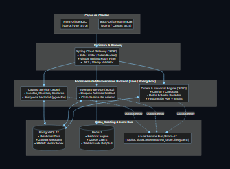
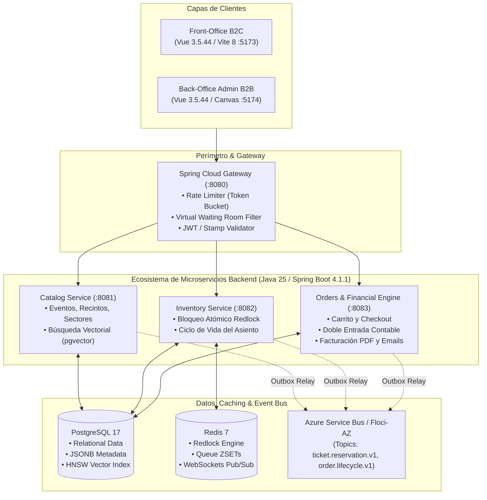

<p align="center">
  
</p>

<p align="center">
  <strong>Plataforma Cloud-Native de Venta de Entradas y Gestión de Inventario de Alta Concurrencia</strong>
</p>

<p align="center">
  
  
  
  
  
  
</p>

---

## 📖 Índice

1. [Visión General del Proyecto](#-visión-general-del-proyecto)
2. [Problemas de Negocio y Soluciones de Ingeniería](#-problemas-de-negocio-y-soluciones-de-ingeniería)
3. [Arquitectura del Sistema](#-arquitectura-del-sistema)
4. [Ecosistema de Microservicios y Clientes](#-ecosistema-de-microservicios-y-clientes)
5. [Stack Tecnológico Integral](#-stack-tecnológico-integral)
6. [Cómo se Planificó el Proyecto](#-cómo-se-planificó-el-proyecto)
7. [Cómo se Realizó (Metodología de Desarrollo)](#-cómo-se-realizó-metodología-de-desarrollo)
8. [Estado Actual: Lo Desarrollado y Verificado (MVP)](#-estado-actual-lo-desarrollado-y-verificado-mvp)
9. [Roadmap: Lo que Falta por Hacer](#-roadmap-lo-que-falta-por-hacer)
10. [Puesta en Marcha Local](#-puesta-en-marcha-local)
11. [Documentación y Especificaciones de API](#-documentación-y-especificaciones-de-api)

---

## 🎯 Visión General del Proyecto

**Hibana.tk** es una plataforma distribuida de misión crítica diseñada para la venta masiva de entradas en espectáculos de alta demanda (estadios, festivales, conciertos y teatros). 

El sistema está concebido para resolver el desafío de **escalabilidad asimétrica**: absorber picos masivos de cientos de miles de usuarios navegando el catálogo de eventos, ordenarlos de manera justa en una **Sala de Espera Virtual** y garantizar que las reservas y compras concurrentes de un mismo asiento se resuelvan de forma atómica en milisegundos con **cero sobreventa (0% double-booking)**.

---

## 💡 Problemas de Negocio y Soluciones de Ingeniería

| Desafío Crítico | Problema en Plataformas Tradicionales | Solución de Ingeniería en Hibana.tk |
| :--- | :--- | :--- |
| **Colisión de Asientos (Double Booking)** | Cientos de usuarios intentan pagar la misma butaca al mismo tiempo, generando sobreventa y reversas bancarias costosas. | **Bloqueo Distribuido Atómico (Redlock en Redis)** con clave `lock:event:{id}:seat:{id}` y TTL estricto de 10 min. 500 hilos virtuales concurrentes disputan un asiento: exactamente 1 adquiere la reserva temporal y 499 son rechazados con `409 Conflict`. |
| **Saturación en Ventas Masivas** | La avalancha de tráfico inicial derriba las bases de datos transaccionales. | **Virtual Waiting Room (Redis Sorted Sets):** Cola FIFO ordenada por timestamp (`queue:event:{id}`). El API Gateway bloquea el acceso a inventario mediante el filtro `CheckoutTokenFilterFactory`, exigiendo un token firmado temporal `X-Checkout-Token`. |
| **Doble Escritura (Dual Write Problem)** | Si el servicio guarda la reserva en BD pero se cae antes de emitir el evento a la cola de mensajería, el sistema queda inconsistente. | **Transactional Outbox Pattern:** La mutación de la entidad y el evento de dominio se persisten en una única transacción local ACID (`outbox_events`). Un worker desacoplado con `FOR UPDATE SKIP LOCKED` despacha los eventos a Azure Service Bus con garantía *at-least-once*. |
| **Mapas de Recintos Masivos en Frontend** | Intentar renderizar 50.000 asientos como nodos DOM/SVG congela el navegador del operador o comprador. | **Renderizado en HTML5 Canvas:** El mapa interactivo se procesa en el canvas del navegador, soportando miles de localidades fluidas a 60 FPS con zoom y paneo continuo. |
| **Fraude por Capturas de Pantalla y Reventa** | Entradas con QR estáticos compartidas o revendidas a múltiples compradores. | **Dynamic QR (TOTP / Rotating Seed):** Código QR de un solo uso que rota cada 15–30 segundos mediante HMAC-SHA256, con tokens firmados asimétricamente para permitir validación offline en molinetes. |

---

## 🏛️ Arquitectura del Sistema

El ecosistema sigue los principios de **Domain-Driven Design (DDD)** con fronteras de contexto (*Bounded Contexts*) estrictas y **Arquitectura Hexagonal (Puertos y Adaptadores)**:

<p align="center">
  
</p>

<details>
<summary><b>Ver definición del diagrama en Mermaid</b></summary>


</details>

---

## 📦 Ecosistema de Microservicios y Clientes

### 1. Clientes Frontend (Aislamiento B2C vs B2B)
* **`ticketing-frontend` (Front-Office B2C):** Cliente público para compradores. Interfaz reactiva en Vue 3.5.44 con Tailwind CSS, exploración de eventos, sala de espera interactiva en tiempo real y flujo de compra guiado.
* **`ticketing-admin` (Back-Office B2B):** Portal exclusivo para productores, administradores y operadores de soporte técnico. Aislado para operar independientemente de la carga pública, con canvas de recintos y paneles de métricas.

### 2. Microservicios Backend
* **`ticketing-app-gateway` (Puerto :8080):** Puerta de enlace con Spring Cloud Gateway, terminación TLS, limitación de tasa por IP, disyuntores de circuito (Resilience4j) y agregación de contratos OpenAPI/AsyncAPI.
* **`ticketing-app-catalog` (Puerto :8081):** Gestión de espectáculos, recintos, organizadores y sectores de precios. Almacena metadatos y políticas en columnas `JSONB` de PostgreSQL, y mapas vectoriales de recintos servidos desde Blob Storage.
* **`ticketing-app-inventory` (Puerto :8082):** Motor transaccional del asiento (`Seat` y `TicketReservation`). Implementa el algoritmo Redlock en Redis con liberación pasiva (TTL) y activa por compensación de Saga.
* **`ticketing-app-orders` (Puerto :8083):** Procesamiento de órdenes y pagos, emisión de facturas oficiales en PDF (OpenPDF), despacho de confirmaciones por email y motor contable de doble entrada (`com.aieta.pocket`).

---

## 🛠️ Stack Tecnológico Integral

* **Lenguaje & Plataforma:** **Java 25** con **Spring Boot 4.1.1**, aprovechando **Virtual Threads (Project Loom)** para I/O concurrente sin saturar hilos del sistema operativo.
* **Frontend:** Vue 3.5.44 (Composition API con `<script setup>`), TypeScript, Pinia 4, Vite 8, Tailwind CSS y HTML5 Canvas.
* **Bases de Datos & Persistencia:** 
  - **PostgreSQL 17**: Persistencia relacional ACID, esquemas versionados con **Flyway**, columnas semiestructuradas **JSONB** para configuración de medios y políticas de venta.
  - **pgvector**: Búsqueda vectorial semántica con indexación **HNSW** para recomendaciones de espectáculos basadas en distancia coseno.
* **Caché & Concurrencia:** **Redis 7** (Redlock con scripts Lua atómicos, colas FIFO en Sorted Sets `ZSET`, y canales Pub/Sub para WebSockets).
* **Mensajería Distribuida:** **Azure Service Bus** (Topics & Subscriptions) bajo coreografía de eventos y orquestación **Saga**.
* **Seguridad & IAM:** **Microsoft Entra ID** (OAuth2/OIDC, tokens JWT validados perimetralmente), RBAC (`ROLE_USER`, `ROLE_ADMIN`, `ROLE_OPERATOR`) y Azure Key Vault con Managed Identities.
* **Entorno de Emulación:** **Floci-AZ** para emular servicios Azure (Key Vault, Service Bus, Blob Storage) localmente a costo cero, y **Mailpit** para inspección SMTP de emails transaccionales.

---

## 📋 Cómo se Planificó el Proyecto

El proyecto se estructuró siguiendo la metodología **Spec-Driven Development (SDD)**:

1. **Diseño de Contratos Antes del Código:** 
   - Definición de especificaciones OpenAPI 3.1 (`gateway-api.yaml`) para los endpoints REST.
   - Definición de especificaciones AsyncAPI 3.0 (`servicebus-events.yaml`) para la topología de eventos del Service Bus.
2. **Modelado de Dominio (DDD):** 
   - Mapeo de agregados de negocio puros (`Seat`, `Reservation`, `Order`, `LedgerAccount`) aislados de frameworks en el núcleo de cada microservicio.
3. **Planes de Trabajo Incrementales:**
   - Creación de planes de arquitectura C4, flujos de reserva, estados de checkout y planes de mitigación de seguridad documentados en `docs/plans/` y `docs/architecture/`.

---

## ⚙️ Cómo se Realizó (Metodología de Desarrollo)

* **Arquitectura Hexagonal Estricta:** Las capas de dominio no contienen anotaciones de Spring ni dependencias de JPA; la interacción con base de datos, Redis o Service Bus se realiza exclusivamente a través de puertos e interfaces adaptadoras.
* **Verificación de Concurrencia Extrema:** Creación de tests de estrés multihilo que levantan **500 hilos virtuales concurrentes** colisionando contra el mismo asiento para comprobar que el bloqueo atómico garantiza 0% de doble reserva.
* **Aislamiento en Ramas y Worktrees:** Desarrollo modular independiente por servicio, asegurando límites limpios y sin dependencias cruzadas en tiempo de compilación.

---

## ✅ Estado Actual: Lo Desarrollado y Verificado (MVP)

- [x] **Infraestructura Completa en Docker Compose:** Contenedores de PostgreSQL 17 (con `pgvector`), Redis 7, Floci-AZ (Azure Emulation) y Mailpit operativos con un solo comando.
- [x] **Catalog Microservice (:8081):** Migraciones Flyway `V1` y `V2`, endpoints REST de eventos y recintos, y precarga de planos de recintos en Blob Storage.
- [x] **Inventory Microservice (:8082):** Bloqueo atómico Redlock (TTL 10 min), reservas temporales `PENDING` -> `CONFIRMED`, endpoints de reserva y Transactional Outbox.
- [x] **Orders & Financial Engine (:8083):** Creación de órdenes reales, procesamiento de pagos con tarjeta de débito/crédito, generación de facturas oficiales en PDF y envío de correos transaccionales a Mailpit.
- [x] **Gateway & Virtual Waiting Room (:8080):** Enrutamiento perimetral, rate limiting por IP, cola virtual en Redis y validación del `X-Checkout-Token`.
- [x] **Frontend B2C (:5173):** Catálogo con filtros y búsqueda, detalle de show, integración reactiva con la sala de espera virtual, selección de asientos por mapa interactivo y flujo de checkout conectado de punta a punta con el backend.
- [x] **Saga de Confirmación (Orders ➔ Inventory):** Confirmación automática del asiento en inventario al completarse el pago de la orden.

---

## 🚀 Roadmap: Lo que Falta por Hacer

- [ ] **Módulo de Mercado Pago:** Completar la integración formal del Checkout Pro y reconciliación de webhooks con firma criptográfica (actualmente protegido mediante Feature Flag configurable).
- [ ] **Back-Office Admin Portal (:5174):** Completar el constructor visual de recintos y consola de operadores sobre el lienzo de HTML5 Canvas planificado en `docs/plans/admin-portal-implementation-plan.md`.
- [ ] **Sistema de Acceso con QR Dinámico (TOTP):** Implementar la rotación de códigos QR cada 15–30 segundos en la pantalla de "Mis Entradas" y la API de molinete descrita en `docs/specs/qr-access-control.md`.
- [ ] **Motor de Recomendaciones IA en Producción:** Conectar el pipeline de embeddings y seguimiento de experimentos con MLflow para notificaciones personalizadas basadas en afinidad de usuario.
- [ ] **Pruebas de Estrés Distribuidas (k6 / Gatling):** Ejecutar benchmarks de carga a gran escala simulando más de 50.000 usuarios en cola en el API Gateway.

---

## 💻 Puesta en Marcha Local

### Prerrequisitos
* Docker Desktop instalado y en ejecución.
* JDK 21 o JDK 25 instalado.
* Node.js 20+ y npm/bun.

### 1. Levantar la Infraestructura Local
```bash
docker compose up -d
```
Esto inicializará PostgreSQL (`:5432`), Redis (`:6379`), Floci-AZ (`:4577`) y Mailpit (`:8025`).

### 2. Iniciar los Microservicios Backend
En terminales independientes, ejecutar:
```bash
# Gateway
cd ticketing-app-gateway && ./gradlew bootRun

# Catalog Service
cd ticketing-app-catalog && ./gradlew bootRun

# Inventory Service
cd ticketing-app-inventory && ./gradlew bootRun

# Orders Service
cd ticketing-app-orders && ./gradlew bootRun
```

*(Opcional: usar el script de desarrollo automatizado `dev.ps1`).*

### 3. Iniciar el Frontend (B2C)
```bash
cd ticketing-frontend
npm install
npm run dev
```
Acceder a la aplicación en [http://localhost:5173](http://localhost:5173).

---

## 📚 Documentación y Especificaciones de API

La documentación técnica detallada se encuentra centralizada en la carpeta [`docs/`](docs/):

* **Especificación de Arquitectura:** [`docs/architecture/Ticketing-app.md`](docs/architecture/Ticketing-app.md)
* **Diagramas C4 y Secuencias:** [`docs/architecture/diagrams/`](docs/architecture/diagrams/)
* **Contratos OpenAPI 3.1:** [`docs/specs/openapi/gateway-api.yaml`](docs/specs/openapi/gateway-api.yaml)
* **Contratos de Eventos AsyncAPI 3.0:** [`docs/specs/asyncapi/servicebus-events.yaml`](docs/specs/asyncapi/servicebus-events.yaml)
* **Guía de Autenticación y Emulador Azure:** [`docs/architecture/azure-authentication-floci-emulation.md`](docs/architecture/azure-authentication-floci-emulation.md)
* **Control de Acceso QR Dinámico:** [`docs/specs/qr-access-control.md`](docs/specs/qr-access-control.md)
* **Inspección de Emails de Prueba:** [http://localhost:8025](http://localhost:8025) (Mailpit)
