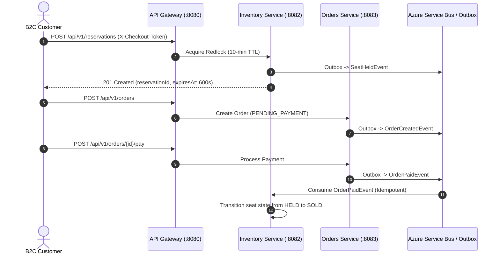

# Hibana Ticketing - Complete Microservices API & Event Documentation

This guide provides the authoritative documentation for all synchronous HTTP endpoints, asynchronous event-bus contracts, and real-time WebSocket channels across the Hibana platform.

It adheres to the **Spring Boot 4 (Java 25) Hexagonal + CQRS Architecture** and the **OpenAPI 3.1 / AsyncAPI 3.0** open standards.

---

## 1. Architecture & Specification Topology

Because Hibana is an event-driven distributed system operating behind an edge API Gateway, API documentation is organized into three contract files in [`docs/specs/`](./specs):

```text
docs/specs/
├── openapi/
│   └── gateway-api.yaml      # OpenAPI 3.1: All public endpoints exposed via Spring Cloud Gateway
├── asyncapi/
│   └── servicebus-events.yaml # AsyncAPI 3.0: Azure Service Bus Topics, Outbox Events & WebSockets
└── api-documentation-guide.md # Master architectural catalogue (this file)
```

---

## 2. Complete Synchronous REST Endpoints Matrix

All client traffic (`www.hibana.tk` and `admin.hibana.tk`) enters through the edge **Spring Cloud Gateway** (`:8080`), which handles rate limiting, circuit breaking, and waiting-room token verification.

| HTTP Method | Gateway Route Path | Downstream Service | Target Port | Security / Headers Required | Rate Limit (Redis) | Circuit Breaker | Description |
| :--- | :--- | :--- | :--- | :--- | :--- | :--- | :--- |
| **POST** | `/api/v1/queue/join` | `ticketing-app-gateway` | `8080` (Native) | None (Public) | 100 req/min | N/A | Enqueue user into Redis Sorted Set for high-demand ticket sales |
| **GET** | `/api/v1/queue/status` | `ticketing-app-gateway` | `8080` (Native) | None (Public) | 100 req/min | N/A | Poll queue position, ETA, and obtain `X-Checkout-Token` |
| **GET** | `/api/v1/queue/stream` | `ticketing-app-gateway` | `8080` (Native) | None (Public) | None | N/A | Server-Sent Events (SSE) real-time queue position updates |
| **GET** | `/api/v1/events` | `ticketing-app-catalog` | `8081` | None (Public) | 100 req/min | `catalogCircuitBreaker` | List upcoming spectacles; supports `?category=`, `?q=`, `?venue=` |
| **GET** | `/api/v1/events/highlights`| `ticketing-app-catalog` | `8081` | None (Public) | 100 req/min | `catalogCircuitBreaker` | Curated homepage events (cached with `stale-while-revalidate`) |
| **GET** | `/api/v1/events/meta` | `ticketing-app-catalog` | `8081` | None (Public) | 100 req/min | `catalogCircuitBreaker` | Global catalog metadata (furthest event date, registered venues) |
| **GET** | `/api/v1/events/search` | `ticketing-app-catalog` | `8081` | None (Public) | 100 req/min | `catalogCircuitBreaker` | Full-text and vector search for events and venues |
| **GET** | `/api/v1/events/{id}` | `ticketing-app-catalog` | `8081` | None (Public) | 100 req/min | `catalogCircuitBreaker` | Event entity with sectors, base pricing, and seat map URL |
| **POST** | `/api/v1/admin/events` | `ticketing-app-catalog` | `8081` | `ROLE_ADMIN` (Bearer JWT) | None (Admin) | `catalogCircuitBreaker` | Create event with sectors and initialize catalog projection |
| **POST** | `/api/v1/admin/events/{id}/publish` | `ticketing-app-catalog` | `8081` | `ROLE_ADMIN` (Bearer JWT) | None (Admin) | `catalogCircuitBreaker` | Publish draft event to `ON_SALE` |
| **POST** | `/api/v1/admin/events/{id}/cancel` | `ticketing-app-catalog` | `8081` | `ROLE_ADMIN` (Bearer JWT) | None (Admin) | `catalogCircuitBreaker` | Cancel event and initiate automated refund Saga |
| **GET** | `/api/v1/events/{eventId}/seats` | `ticketing-app-inventory`| `8082` | None (Public) | 100 req/min | `inventoryCircuitBreaker`| Real-time seat occupancy status (`AVAILABLE`, `HELD`, `SOLD`) |
| **POST** | `/api/v1/reservations` | `ticketing-app-inventory`| `8082` | **`X-Checkout-Token`** (JWT) | 100 req/min | `inventoryCircuitBreaker`| Atomic Redlock hold on seat for **10 minutes** (`lock:event:{id}:seat:{id}`) |
| **POST** | `/api/v1/reservations/{id}/confirm`| `ticketing-app-inventory`| `8082` | Internal / Service | None | `inventoryCircuitBreaker`| Marks reservation confirmed upon successful payment |
| **DELETE**| `/api/v1/reservations/{id}`| `ticketing-app-inventory`| `8082` | `BearerAuth` or System | 100 req/min | `inventoryCircuitBreaker`| Active lock release (user abandoned seat or Saga compensation) |
| **POST** | `/api/v1/orders` | `ticketing-app-orders` | `8083` | `X-User-Id`, `Trace-ID` | 100 req/min | `ordersCircuitBreaker` | Initiates purchase order from reservation in `PENDING_PAYMENT` |
| **GET** | `/api/v1/orders/{orderId}`| `ticketing-app-orders` | `8083` | `X-User-Id` | 100 req/min | `ordersCircuitBreaker` | Get order status, line items, and expiration countdown |
| **GET** | `/api/v1/orders/me` | `ticketing-app-orders` | `8083` | `X-User-Id` (Bearer JWT) | 100 req/min | `ordersCircuitBreaker` | Paginated purchase history for authenticated customer |
| **POST** | `/api/v1/orders/{orderId}/pay` | `ticketing-app-orders` | `8083` | `X-User-Id`, `Trace-ID` | 100 req/min | `ordersCircuitBreaker` | Authorize credit card / Mercado Pago payment for order |
| **POST** | `/api/v1/orders/{orderId}/cancel` | `ticketing-app-orders` | `8083` | `X-User-Id` | 100 req/min | `ordersCircuitBreaker` | Cancel order and trigger Saga compensation |
| **GET** | `/api/v1/orders/{orderId}/invoice` | `ticketing-app-orders` | `8083` | `X-User-Id` | 100 req/min | `ordersCircuitBreaker` | Download fiscal tax invoice PDF (`application/pdf`) |
| **POST** | `/api/v1/webhooks/mercadopago` | `ticketing-app-orders` | `8083` | Webhook signature | None | None | Asynchronous payment gateway status notification |

---

## 3. Asynchronous Event Mesh & Saga Contracts (AsyncAPI 3.0)

All cross-service mutations execute asynchronously over **Azure Service Bus** using the **Transactional Outbox Pattern** to prevent dual-write bugs. Every message includes standard headers:
- `eventId`: UUIDv7 unique idempotency key for consumer deduplication.
- `eventType`: Qualified domain event name.
- `traceId`: Propagated W3C distributed trace ID.
- `timestamp`: UTC ISO-8601 creation timestamp.



### Event Catalogue

| Topic / Channel | Domain Event | Origin Producer | Primary Consumers | Purpose & Invariant |
| :--- | :--- | :--- | :--- | :--- |
| `topics/catalog.events` | `EventCreatedEvent` | `ticketing-app-catalog` | `ticketing-app-inventory` | Allocates physical seat layout in inventory database |
| `topics/catalog.events` | `EventPublishedEvent` | `ticketing-app-catalog` | Recommendation Engine, Cache | Invalidate public CDN cache and enable sales |
| `topics/catalog.events` | `EventCancelledEvent` | `ticketing-app-catalog` | `ticketing-app-orders`, Inventory | Triggers automated refund Saga and releases all seats |
| `topics/inventory.events` | `SeatHeldEvent` | `ticketing-app-inventory`| Orders, Analytics | Notifies seat hold under Redlock key `lock:event:{id}:seat:{id}` |
| `topics/inventory.events` | `SeatReleasedEvent` | `ticketing-app-inventory`| Cache, Waiting Room | Emitted on 10-min TTL expiration or explicit cancellation |
| `topics/inventory.events` | `ReservationConfirmedEvent` | `ticketing-app-inventory` | Notifications | Emitted when seat is permanently marked SOLD |
| `topics/orders.events` | `OrderCreatedEvent` | `ticketing-app-orders` | Financial Engine | Registers uncommitted balance in double-entry ledger |
| `topics/orders.events` | `OrderPaidEvent` | `ticketing-app-orders` | `ticketing-app-inventory`, Mailer | Authorizes checkout Saga completion and ticket PDF dispatch |
| `topics/orders.events` | `PaymentFailedEvent` | `ticketing-app-orders` | `ticketing-app-inventory` | Triggers compensation: releases seat lock immediately |
| `topics/orders.events` | `OrderCancelledEvent` | `ticketing-app-orders` | `ticketing-app-inventory` | Active customer cancellation: triggers refund and seat release |

---

## 4. Real-Time WebSockets (Customer Support & Ops)

Live chat between customers and operators runs over **Spring WebFlux WebSockets** backed by **Redis Pub/Sub**:

- **Endpoint**: `ws://api.hibana.tk/ws/chat/{ticketId}`
- **Handshake Protocol**: STOMP over WebSocket
- **Redis Channel**: `chat.room.{ticketId}`
- **Frame Schema**:
  ```json
  {
    "ticketId": "3fa85f64-5717-4562-b3fc-2c963f66afa6",
    "senderId": "usr-8849-ab2",
    "senderRole": "USER", // "USER" | "OPERATOR" | "AI_ASSISTANT"
    "message": "Hello, I have an inquiry regarding my seat reservation.",
    "timestamp": "2026-11-01T22:15:00Z"
  }
  ```

---

## 5. How to View & Test Docs Locally

You can preview and test these specifications locally without starting the entire Java microservices cluster:

### Option A: Interactive REST Docs via Scalar (Recommended)
Scalar provides a high-performance modern UI superior to classic Swagger:

```bash
# Preview the Gateway OpenAPI contract in your browser
npx @scalar/cli serve docs/specs/openapi/gateway-api.yaml --port 5000
```

### Option B: Interactive Event Docs via AsyncAPI Studio
To view Service Bus topics and WebSocket frames:

```bash
# Preview the Event Mesh & WebSocket contracts
npx @asyncapi/cli start studio -f docs/specs/asyncapi/servicebus-events.yaml
```

### Option C: Lint Specifications in CI/CD
Ensure zero formatting or schema regressions:

```bash
# Validate OpenAPI
npx @redocly/cli lint docs/specs/openapi/gateway-api.yaml

# Validate AsyncAPI
npx @asyncapi/cli validate docs/specs/asyncapi/servicebus-events.yaml
```

---

## 6. Frontend TypeScript Client Generation

To guarantee zero schema drift between the Spring Boot 4 backend and the Vue 3 frontend (`ticketing-frontend`), generate strict TypeScript types directly from `gateway-api.yaml`:

```bash
# Inside ticketing-frontend/
npx openapi-typescript ../docs/specs/openapi/gateway-api.yaml -o src/api/schema.d.ts
```

Your Pinia stores and API clients can then import strict types:
```typescript
import type { paths, components } from '@/api/schema';

type EventResponse = components['schemas']['EventResponse'];
type HoldSeatRequest = components['schemas']['HoldSeatRequest'];
```
