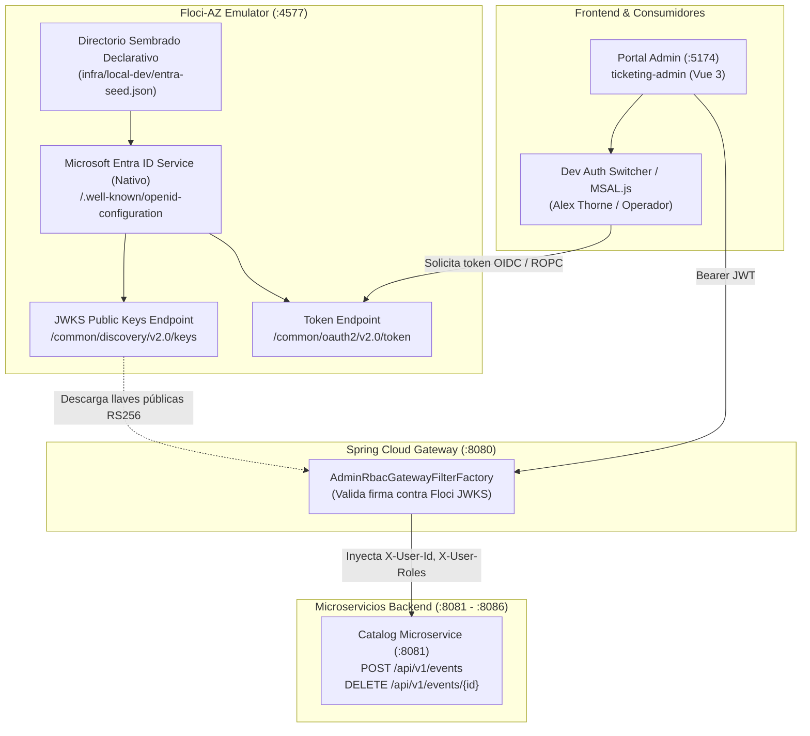

# Emulación de Autenticación de Azure con Floci-AZ & Microsoft Entra ID

**Fecha:** Noviembre 2026  
**Contexto:** Hibana.tk — Plataforma de Gestión y Venta de Entradas  
**Estándar:** Java 25, Spring Boot 4, Spring Cloud Gateway, Floci-AZ (Nativo), Vue 3  

---

## 1. Visión General y Objetivo "Costo Cero"

De acuerdo con las reglas de arquitectura de Hibana.tk ([GEMINI.md](../../GEMINI.md)), el desarrollo y las pruebas locales deben funcionar bajo el principio de **costo cero**, sin requerir suscripciones activas de Azure ni conexión obligatoria a internet.

A diferencia de un mock manual en código Java, **Floci-AZ incorpora un emulador nativo y oficial de Microsoft Entra ID (OIDC)** en el puerto unificado `4577`, proveyendo llaves criptográficas RS256, discovery OIDC y endpoints de autorización y emisión de tokens.



---

## 2. Capacidades Nativas de Microsoft Entra ID en Floci-AZ

Floci-AZ provee un servidor OpenID Connect completo con paridad con Azure:

* **Puerto Unificado:** `http://localhost:4577` (plano de datos, Key Vault, Cosmos DB y Entra ID en el mismo puerto).
* **Endpoints OIDC Expuestos:**
  * `GET /{tenant}/v2.0/.well-known/openid-configuration`: Metadatos OIDC estándar.
  * `GET /{tenant}/discovery/v2.0/keys`: JWKS con llaves públicas `RS256` estables.
  * `POST /{tenant}/oauth2/v2.0/token`: Emisión de tokens soportando `authorization_code`, `client_credentials`, `password` (ROPC) y `refresh_token`.
  * `GET /{tenant}/oauth2/v2.0/authorize`: Soporta flujo interactivo de navegador con **PKCE** para SPAs.
* **Tokens Criptográficamente Válidos:** Emite JWTs reales firmados con algoritmo RS256 conteniendo claims estándar (`iss`, `sub`, `aud`, `oid`, `tid`, `uti`, `roles` o pertenencia a grupos).
* **Autenticación Permisiva por Defecto:** Permite que las llamadas locales con `ClientSecretCredential` o logins de desarrollo funcionen de inmediato sin fricciones de configuración de red.

---

## 3. Sembrado Declarativo de Directorio (`entra-seed.json`)

Floci-AZ soporta la inicialización declarativa de aplicaciones, usuarios y grupos mediante la variable de entorno `FLOCI_AZ_SERVICES_ENTRA_SEED_FILE`.

### 3.1 Estructura del Archivo (`infra/local-dev/entra-seed.json`)

```json
{
  "tenantId": "00000000-0000-0000-0000-000000000002",
  "applications": [
    {
      "id": "app-admin-portal-01",
      "appId": "hibana-admin-portal",
      "displayName": "Hibana Admin Portal",
      "clientSecret": "dev-admin-secret"
    }
  ],
  "users": [
    {
      "id": "usr-alex-thorne-01",
      "userPrincipalName": "alex.thorne@hibana.tk",
      "displayName": "Alex Thorne",
      "mail": "alex.thorne@hibana.tk"
    },
    {
      "id": "usr-operator-01",
      "userPrincipalName": "operator@hibana.tk",
      "displayName": "Operador de Guardia",
      "mail": "operator@hibana.tk"
    },
    {
      "id": "usr-public-01",
      "userPrincipalName": "user@hibana.tk",
      "displayName": "Usuario Regular",
      "mail": "user@hibana.tk"
    }
  ],
  "groups": [
    {
      "id": "grp-role-admin",
      "displayName": "ROLE_ADMIN",
      "securityEnabled": true,
      "members": [
        "usr-alex-thorne-01"
      ]
    },
    {
      "id": "grp-role-operator",
      "displayName": "ROLE_OPERATOR",
      "securityEnabled": true,
      "members": [
        "usr-alex-thorne-01",
        "usr-operator-01"
      ]
    }
  ]
}
```

### 3.2 Montaje en `docker-compose.yml`

```yaml
  floci-az:
    image: floci/floci-az:latest
    container_name: floci-az
    ports:
      - "4577:4577"
      - "5673:5673"
    environment:
      FLOCI_AZ_STORAGE_MODE: hybrid
      FLOCI_AZ_STORAGE_PERSISTENT_PATH: /app/data
      FLOCI_AZ_HOSTNAME: localhost
      FLOCI_AZ_BASE_URL: http://localhost:4577
      FLOCI_AZ_SERVICES_ENTRA_SEED_FILE: /app/config/entra-seed.json
    volumes:
      - ${USERPROFILE:-~}/.floci-studio/data:/app/data
      - ./infra/local-dev/entra-seed.json:/app/config/entra-seed.json:ro
      - /var/run/docker.sock:/var/run/docker.sock
```

---

## 4. Control de Acceso RBAC en Spring Cloud Gateway

El Gateway (`ticketing-app-gateway`) actúa como el punto perimetral de validación de seguridad:

1. **Filtro `AdminRbacGatewayFilterFactory`**:
   * Intercepta peticiones con el header `Authorization: Bearer <token>`.
   * Valida la firma del token contra las llaves públicas de Floci-AZ (`http://localhost:4577/common/discovery/v2.0/keys`) utilizando un decodificador reactivo con caché de JWKS.
   * Verifica los roles del usuario (`ROLE_ADMIN` y/o `ROLE_OPERATOR`).
   * Si falta el token o la firma es inválida: responde **HTTP 401 Unauthorized** (ProblemDetail RFC 7807).
   * Si el usuario no tiene los roles requeridos (ej. `ROLE_USER`): responde **HTTP 403 Forbidden** (ProblemDetail RFC 7807).
   * Si es autorizado: inyecta encabezados de identidad confiables para los microservicios:
     * `X-User-Id`: identificador de usuario (`sub` o `oid`).
     * `X-User-Roles`: lista de roles (`ROLE_ADMIN,ROLE_OPERATOR`).
     * `X-User-Email`: correo institucional (`preferred_username` o `mail`).
     * `X-Gateway-Auth-Stamp`: marca temporal de validación perimetral.

2. **Rutas Administrativas Protegidas en `application.yml`**:
   * Ruta `catalog-admin-mutations` (Orden 30 - alta precedencia):
     * `Path=/api/v1/events/**, /api/v1/venues/**, /api/v1/admin/**`
     * `Method=POST,PUT,PATCH,DELETE`
     * Filtro: `AdminRbac` con `requiredRoles: [ROLE_ADMIN, ROLE_OPERATOR]`.
   * La ruta pública de consultas `catalog-service` (Orden 100) permanece abierta para operaciones de lectura `GET /api/v1/events/**`.

---

## 5. Integración con el Frontend `ticketing-admin`

El portal de administración (`admin.hibana.tk` / `http://localhost:5174`) se comunica directamente con Floci-AZ en desarrollo local:

* **En Local (`.env.development`):**
  * `VITE_ENTRA_AUTHORITY=http://localhost:4577/common`
  * `VITE_ENTRA_CLIENT_ID=hibana-admin-portal`
  * Para desarrollo rápido, el panel superior cuenta con un selector de perfiles que obtiene el token mediante el flujo Resource Owner Password (ROPC) contra `http://localhost:4577/common/oauth2/v2.0/token`, permitiendo alternar entre *Alex Thorne*, *Operador* y *Usuario Regular* con un solo clic.
* **En Producción (`.env.production`):**
  * `VITE_ENTRA_AUTHORITY=https://login.microsoftonline.com/{tenantId}`
  * `VITE_ENTRA_CLIENT_ID={appRegistrationId}`
  * Utiliza `@azure/msal-browser` para login interactivo institucional con Azure Active Directory.

---

## 6. Fases de Ejecución

1. **Fase 1:** Crear el archivo seed `infra/local-dev/entra-seed.json` y actualizar `docker-compose.yml`.
2. **Fase 2:** Implementar `AdminRbacGatewayFilterFactory` en `ticketing-app-gateway` conectado a las JWKS de Floci-AZ.
3. **Fase 3:** Configurar las rutas administrativas en `application.yml` del Gateway.
4. **Fase 4:** Crear la suite de pruebas unitarias y de integración para validar rechazos (401 / 403) y accesos válidos (200).
5. **Fase 5:** Verificación end-to-end con `floci-az` en ejecución.
