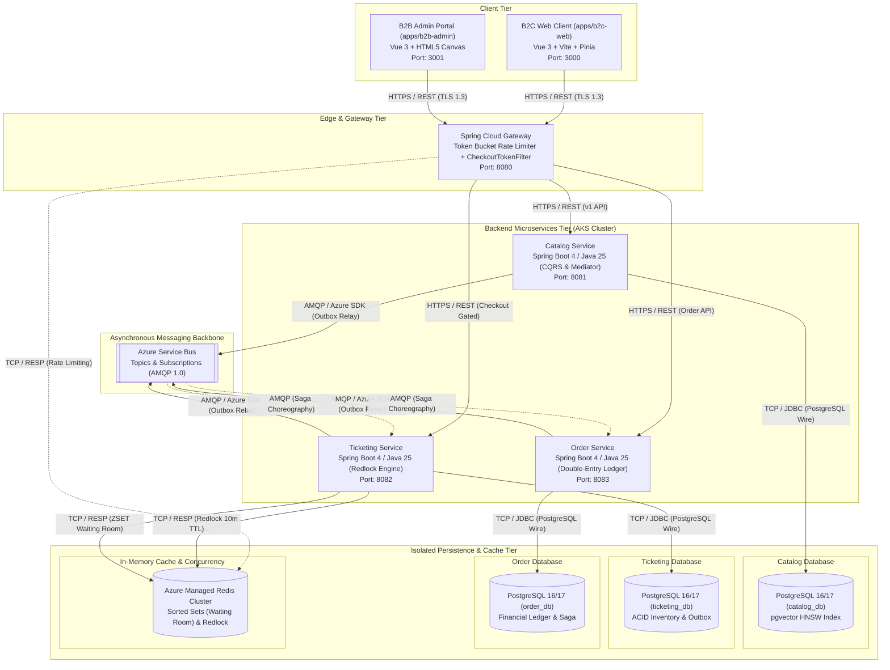

# Architecture Diagram 01: System Containers & Topology (C4 Level 2)

---

## Container Architecture Specifications

| Container | Core Responsibility | Tech Stack | Primary Datastore / Protocol |
| :--- | :--- | :--- | :--- |
| **B2C Web Client** | Public customer experience, event discovery, queue waiting, interactive seat picker, checkout. | Vue 3, Vite, Pinia, TailwindCSS | HTTPS / REST to Gateway |
| **B2B Admin Portal** | Event organizers & operations portal, venue creation, seat map editor with high-performance canvas rendering. | Vue 3, Vite, HTML5 Canvas, Pinia | HTTPS / REST to Gateway (Isolated VNet) |
| **API Gateway** | Perimeter entry, TLS termination, IP-based Token Bucket rate limiting (100 req/min), `X-Checkout-Token` verification, trace propagation. | Spring Boot 4, Spring Cloud Gateway, Redis Reactive | Redis (Token Bucket & Session Claims) |
| **Catalog Service** | Events and venue metadata management, schedule indexing, semantic search queries using vector similarity. | Java 25, Spring Boot 4, Spring Data JPA, pgvector | PostgreSQL (`catalog_db` with `pgvector` HNSW index) |
| **Ticketing Service** | High-concurrency seat inventory, atomic reservation holds via Redlock, bulk seat provisioning, virtual waiting room queue. | Java 25, Spring Boot 4, Redisson / Lettuce, Outbox Pattern | PostgreSQL (`ticketing_db`) + Redis (Redlock & ZSETs) |
| **Order Service** | Checkout orchestration, payment lifecycle integration, double-entry ledger bookkeeping (`com.aieta.pocket`), Choreographed Saga participant. | Java 25, Spring Boot 4, Transactional Outbox | PostgreSQL (`order_db`) |
| **Azure Service Bus** | Resilient asynchronous event-driven communications backbone connecting microservices with at-least-once delivery. | Azure Service Bus (Topics & Subscriptions) | AMQP 1.0 protocol |
| **Azure Cache for Redis** | Microsecond-latency cache, atomic distributed locks with TTL, waiting room sorted set queues, and WebSocket Pub/Sub. | Redis 7+ Cluster (Premium Tier) | TCP / RESP protocol |