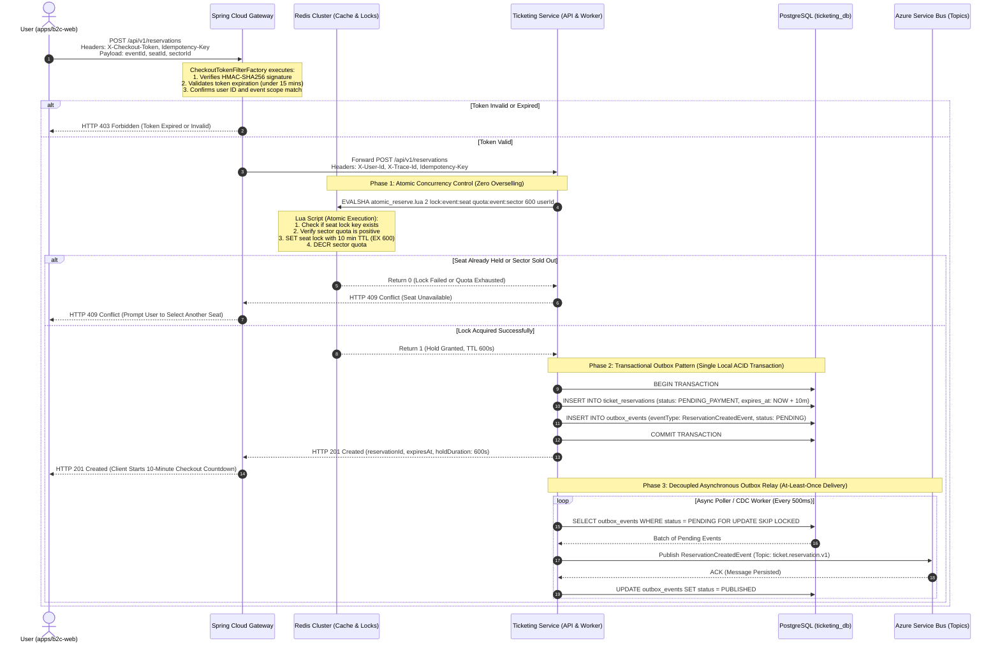

# Architecture Diagram 02: End-to-End High-Concurrency Seat Hold & Reservation Lifecycle

---

## Technical Concurrency Guarantees

1. **Race-Condition Elimination:**
   - The Redis Lua script executes atomically within Redis's single-threaded event loop. If 500 parallel requests hit the exact same seat simultaneously, exactly 1 request acquires the 10-minute key; the remaining 499 evaluate the existing key and return `0` immediately without touching PostgreSQL.
2. **Dual-Write Safety (Transactional Outbox):**
   - The reservation entity and domain event are committed inside the exact same local ACID transaction in `ticketing_db`. Database writes and event emissions can never fall out of sync.
3. **Passive Expiration vs Active Saga Compensation:**
   - **Passive:** If the buyer abandons checkout, the Redis lock evaporates after 600 seconds, and a background reconciliation cleaner transitions `ticket_reservations` to `EXPIRED`.
   - **Active:** If payment fails in the Saga, an explicit compensating action deletes the Redis key and updates status to `CANCELLED` within milliseconds.