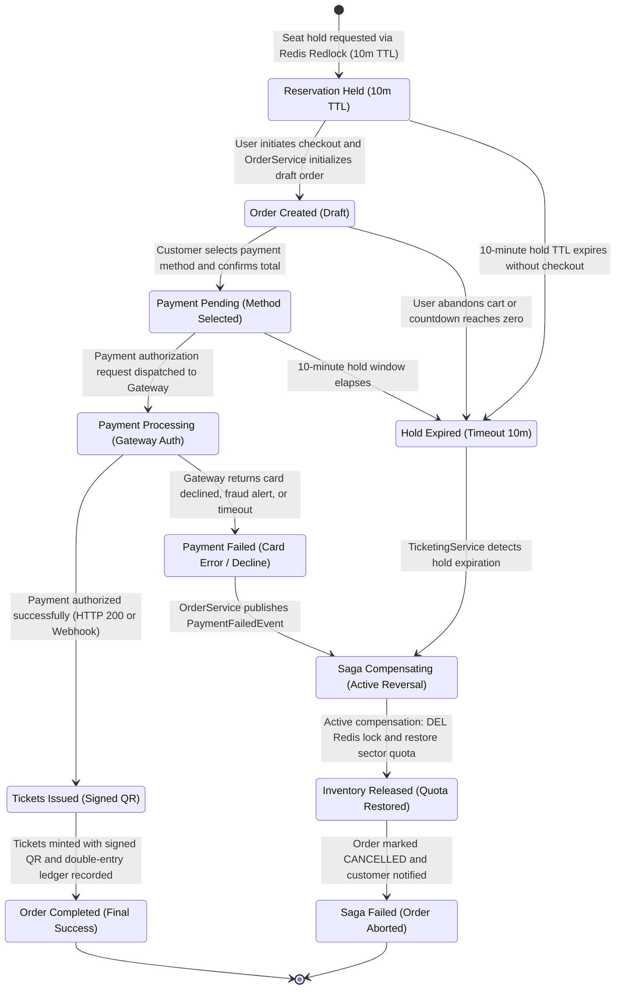

# Architecture Diagram 03: Distributed Checkout Saga State Machine (CheckoutSaga)

---

## Saga Execution & Compensation Matrix

| Current State | Trigger Event | Handling Service | Success Action | Compensating Action (Upon Failure / Timeout) |
| :--- | :--- | :--- | :--- | :--- |
| **RESERVATION_HELD** | `SeatHoldRequested` | `ticketing-service` | Acquire Redlock in Redis with 10m TTL (600s), insert `ticket_reservations`. | Passive TTL expiration; key deleted from Redis if user cancels early. |
| **ORDER_CREATED** | `ReservationCreatedEvent` | `order-service` | Create Order aggregate with status `PENDING_PAYMENT`, calculate taxes & fees. | Publish `OrderCancelledEvent` if customer abandons cart. |
| **PAYMENT_PENDING** | `PaymentInitiatedEvent` | `order-service` | Submit charge request with idempotency token to payment gateway. | Mark order `ABORTED`; trigger inventory release compensation. |
| **PAYMENT_PROCESSING** | `PaymentCapturedEvent` | Payment Gateway / `order-service` | Transition order to `PAID`, trigger ticket issuance and ledger entry. | Gateway decline publishes `PaymentFailedEvent` -> triggers `SAGA_COMPENSATING`. |
| **SAGA_COMPENSATING** | `PaymentFailedEvent` or `HoldExpiredEvent` | `ticketing-service` & `order-service` | Delete Redis reservation lock (`DEL lock:event:{e}:seat:{s}`), `INCR` quota. | Retry compensation via dead-letter queue (DLQ) if Redis connection fails. |
| **INVENTORY_RELEASED** | `InventoryCompensatedEvent` | `ticketing-service` | Update `ticket_reservations` to `CANCELLED`; return seat to `AVAILABLE`. | N/A (Terminal compensation completed). |
| **TICKETS_ISSUED** | `OrderPaidEvent` | `ticketing-service` & `order-service` | Generate cryptographically signed QR codes (`Ed25519`), write double-entry ledger. | Non-reversible once committed; requires administrative manual dispute/refund. |
| **ORDER_COMPLETED** | `TicketsDeliveredEvent` | Notification Worker | Dispatch confirmation email with QR ticket attachments. | Queue email retry on SMTP provider backoff. |