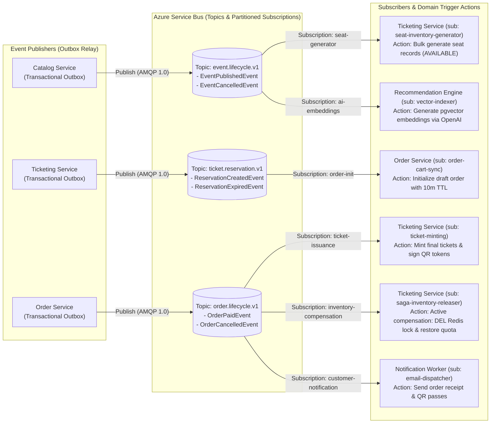

# Architecture Diagram 04: Global Event-Driven Messaging Topology



---

## Universal CloudEvents JSON Metadata Envelope & Schemas

All messages published to Azure Service Bus encapsulate their business payloads inside a standardized, immutable envelope:

```json
{
  "$schema": "https://json-schema.org/draft/2020-12/schema",
  "type": "object",
  "required": ["eventId", "traceId", "occurredAt", "aggregateType", "aggregateId", "eventType", "data"],
  "properties": {
    "eventId": { "type": "string", "format": "uuid" },
    "traceId": { "type": "string", "description": "W3C Trace Context correlation ID propagated from Gateway" },
    "occurredAt": { "type": "string", "format": "date-time" },
    "aggregateType": { "type": "string", "enum": ["Event", "Reservation", "Order"] },
    "aggregateId": { "type": "string" },
    "eventType": { "type": "string" },
    "data": { "type": "object" }
  }
}
```

### Topic 1: `event.lifecycle.v1` (`EventPublishedEvent`)
```json
{
  "eventId": "d290f1ee-6c54-4b01-90e6-d701748f0851",
  "traceId": "4bf92f3577b34da6a3ce929d0e0e4736",
  "occurredAt": "2026-10-15T20:30:00Z",
  "aggregateType": "Event",
  "aggregateId": "evt_coldplay_2026",
  "eventType": "EventPublishedEvent",
  "data": {
    "venueId": "ven_estadio_nacional",
    "slug": "coldplay-music-of-the-spheres-2026",
    "startsAt": "2026-11-20T21:00:00Z",
    "sectors": [
      { "sectorId": "sec_vip_standing", "name": "VIP Standing", "capacity": 5000, "basePrice": 120.00 },
      { "sectorId": "sec_tribuna_andes", "name": "Tribuna Andes", "capacity": 15000, "basePrice": 75.00 }
    ]
  }
}
```

### Topic 2: `ticket.reservation.v1` (`ReservationCreatedEvent`)
```json
{
  "eventId": "e5b8d2a1-9c34-4b82-8419-f0183b1a8291",
  "traceId": "4bf92f3577b34da6a3ce929d0e0e4736",
  "occurredAt": "2026-10-15T20:35:10Z",
  "aggregateType": "Reservation",
  "aggregateId": "res_98a72b1c",
  "eventType": "ReservationCreatedEvent",
  "data": {
    "eventId": "evt_coldplay_2026",
    "userId": "usr_c34d8e90",
    "sectorId": "sec_vip_standing",
    "seatId": "seat_vip_001",
    "expiresAt": "2026-10-15T20:45:10Z",
    "holdDurationSeconds": 600
  }
}
```

### Topic 3: `order.lifecycle.v1` (`OrderPaidEvent`)
```json
{
  "eventId": "f781a29c-12b4-4e9a-bb89-710892c3a101",
  "traceId": "4bf92f3577b34da6a3ce929d0e0e4736",
  "occurredAt": "2026-10-15T20:38:45Z",
  "aggregateType": "Order",
  "aggregateId": "ord_88291a0c",
  "eventType": "OrderPaidEvent",
  "data": {
    "reservationId": "res_98a72b1c",
    "userId": "usr_c34d8e90",
    "totalAmount": 138.00,
    "currency": "USD",
    "paymentProvider": "STRIPE",
    "paymentReference": "ch_3MtwBwLkdIwHu7ix28a3tqPa",
    "tickets": [
      { "ticketId": "tkt_01J9X8A1B2C3", "seatId": "seat_vip_001", "sectorId": "sec_vip_standing" }
    ]
  }
}
```