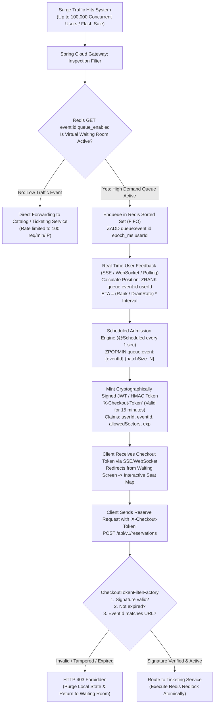

# Architecture Diagram 05: Virtual Waiting Room & Traffic-Shaping Algorithm

---

## Redis Commands & Algorithmic Complexity Analysis

| Phase / Operation | Redis Command | Algorithmic Complexity | Execution Rationale & Performance Impact |
| :--- | :--- | :--- | :--- |
| **Queue State Check** | `GET event:{id}:queue_enabled` | $O(1)$ | Microsecond boolean check per incoming request at the Gateway perimeter. |
| **User Admission (Join)** | `ZADD queue:event:{id} <timestamp_ms> <user_id>` | $O(\log N)$ | Preserves strictly fair FIFO ordering using arrival millisecond timestamp as the score. $N = 100{,}000$ requires $\approx 17$ internal skiplist pointer operations. |
| **Position Query** | `ZRANK queue:event:{id} <user_id>` | $O(\log N)$ | Retrieves 0-based rank. Enables accurate, dynamic queue progression without full table scans. |
| **Batch Admission (Pop)** | `ZPOPMIN queue:event:{id} <batch_size>` | $O(\log N + M)$ | Atomically pops top $M$ users from the front of the queue to admit into checkout. $M$ is dynamically adjusted based on downstream database write IOPS. |
| **Queue Depth (Telemetry)**| `ZCARD queue:event:{id}` | $O(1)$ | Instantaneous total waiting queue size for Prometheus / Azure Monitor dashboards. |
| **Atomic Seat Locking** | `SET lock:event:{e}:seat:{s} {token} NX EX 600` | $O(1)$ | Atomic Redlock hold; guarantees no two buyers can hold the same seat key concurrently. |
| **Active Release** | `DEL lock:event:{e}:seat:{s}` | $O(1)$ | Millisecond compensation executed upon payment failure or cart abandonment. |