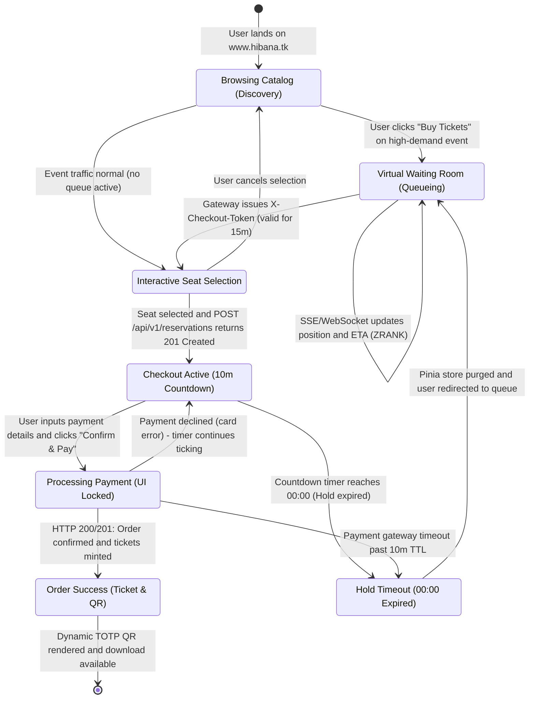

# Architecture Diagram 07: Reactive Frontend State Machine & Checkout Countdown Lifecycle

---

## Pinia Store Architecture & Clock Skew Reconciliation

### 1. Store Modules (`apps/b2c-web`)

- **`useWaitingRoomStore`:**
  - State: `queuePosition`, `estimatedWaitTimeSeconds`, `checkoutToken`, `connectionStatus` (SSE / WebSocket).
  - Actions: `connectQueueStream(eventId)`, `disconnect()`, `setToken(jwt)`.
- **`useCheckoutStore`:**
  - State: `reservationId`, `selectedSeats`, `totalAmount`, `serverExpiresAtMs`, `remainingSeconds`, `idempotencyKey`.
  - Actions: `startHoldTimer(serverExpiresAt)`, `submitPayment(paymentDetails)`, `resetCheckout()`.

### 2. Preventing Client-Side Clock Skew Errors

To prevent user device clock discrepancies from corrupting the 10-minute reservation countdown:

1. **Server Time Synchronization Offset:**
   - On response of `POST /api/v1/reservations`, the client extracts the HTTP `Date` header from the response.
   - Computes clock offset: 
     $$\text{clockOffset} = \text{serverTime} - \text{clientLocalTime}$$
2. **Reconciled Countdown Calculation:**
   - The countdown timer ticks locally via `requestAnimationFrame` or `setInterval(1000)` using the server reference:
     $$\text{remainingMs} = \text{serverExpiresAtMs} - (\text{Date.now()} + \text{clockOffset})$$
3. **Route Navigation Guard (`vue-router`):**
   - If user attempts to navigate back during `CheckoutActive`, `beforeRouteLeave` intercepts with a confirmation modal warning that their 10-minute hold will be forfeit.