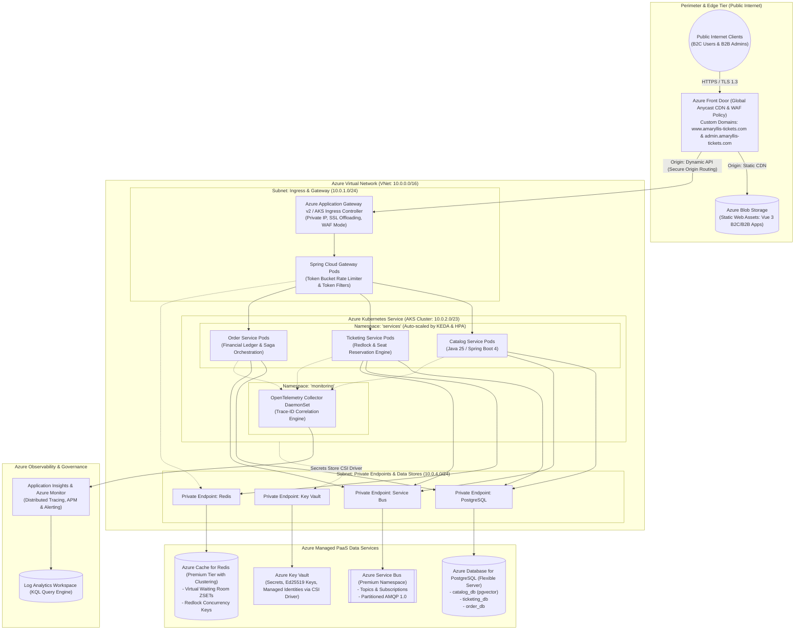

# Architecture Diagram 08: Production Azure Cloud Infrastructure & Network Topology

---

## Local Emulation vs. Azure Production Mapping Matrix

| Local Architecture Component (`docker-compose.yml` / Dev) | Production Azure Cloud Architecture | Scaling & SLA Mechanism |
| :--- | :--- | :--- |
| **`ticketing-postgres` (PostgreSQL 17 Container)** | **Azure Database for PostgreSQL (Flexible Server)** | Zone-redundant High Availability (HA), compute autoscaling, automated point-in-time recovery (PITR). |
| **`ticketing-redis` (Redis 7 Alpine Container)** | **Azure Cache for Redis (Premium P1 Cluster)** | Multi-AZ clustering, Redis data persistence (RDB/AOF), 99.99% availability SLA. |
| **`floci-az` (Local Azure Service Bus Emulator)** | **Azure Service Bus (Premium Tier)** | Dedicated messaging units (MUs), cross-region disaster recovery (Geo-DR), partitioned topics. |
| **Local Environment Variables (`.env`)** | **Azure Key Vault + Managed Identities** | Passwordless authentication (Azure AD/Entra ID), CSI Secrets Store driver injecting k8s secrets. |
| **Docker Compose Bridge Network** | **Azure Virtual Network (VNet) + Private Endpoints** | Microservices isolated from public internet; zero public IPs on backend databases. |
| **Spring Boot Local Logging (SLF4J Console)** | **Application Insights + Log Analytics** | W3C `Trace-ID` distributed end-to-end correlation across all HTTP and AMQP spans. |
| **Local Vite Dev Server (Ports 3000 / 3001)** | **Azure Front Door + Azure Blob Static Website** | Global Anycast Edge CDN, SSL termination at POPs, DDoS Protection Standard. |