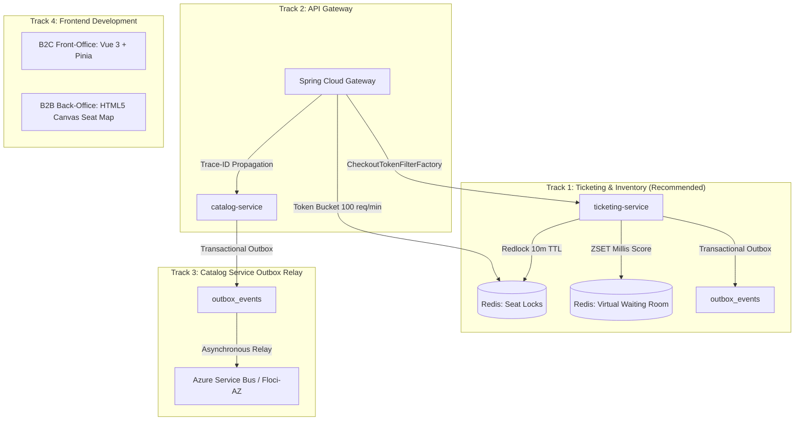

# Session Closing Summary & Proposed Next Steps

- **Date:** 2026-10-15
- **Purpose:** Documenting session decisions, achievements, and prioritized next steps. This file and directory (`docs/temp/`) are excluded from repository tracking via `.gitignore` and serve as working session records.

---

## 1. Accomplishments in Current Session

### A. Database Layer Clean Architecture Reorganization
- Refactored `infrastructure/database/` into four distinct, cohesive packages:
  - `entity/`: `EventJpaEntity`, `EventSectorJpaEntity`, `VenueJpaEntity`
  - `repository/`: `SpringDataEventRepository`, `SpringDataVenueRepository`
  - `adapter/`: `JpaEventRepositoryAdapter` (implementing domain port `EventRepositoryPort`)
  - `mapper/`: `EventMapper`
- Clean separation between Spring Data JPA data models and the pure domain layer.

### B. In-Memory Mediator CQRS Pattern
- Implemented `common/mediator/` (`Request<T>`, `RequestHandler<T, R>`, `Mediator`).
- Grouped use cases into vertical slice folders:
  - `application/query/get_upcoming_events/`
  - `application/query/get_event_by_id/`
- Decoupled `EventController` to interact solely through the `Mediator`.

### C. Spring Boot 4 Native API Versioning
- Configured via `ApiVersionConfigurer` and `PathMatchConfigurer` in `WebVersioningConfig`.
- Supports `/api/v{version}/events` routing dynamically without hardcoded `"v1"` in `@RequestMapping`.

### D. Custom Domain Exceptions & RFC 7807 Handlers
- Pure domain validation exceptions (`InvalidEventScheduleException`, `InvalidEventTitleException`, etc.).
- Centralized `GlobalExceptionHandler` mapping to RFC 7807 `ProblemDetail` with error codes.

### E. Milestone 5 Testing Suite
- Full green suite (16 tests passing):
  - BDD/Gherkin scenario (`catalog_browsing.feature`)
  - Pure unit tests with zero I/O (`EventSummaryValidationTest`)
  - Real database integration tests against PostgreSQL 17 (`EventJpaRepositoryIT`)
  - Multi-threaded concurrency tests (`ConcurrentEventReadTest`)
  - Idempotency & caching tests (`EventReadIdempotencyTest`)

---

## 2. Proposed Next Steps & Decision Matrix

When resuming or starting the next development session, select one of the following architectural tracks:

### Track 1: Bootstrap `ticketing-service` (Recommended Priority)
- **Goal:** Build the high-concurrency seat reservation engine.
- **Key Deliverables:**
  1. Initialize Java 25 + Spring Boot 4 Gradle microservice (`ticketing-app-inventory` or `ticketing-app-ticketing`).
  2. Implement **Redlock** algorithm via Azure Cache for Redis / local Redis 7:
     - Pattern: `lock:event:{eventId}:seat:{seatId}`
     - Strict 10-minute TTL with auto-release and Saga compensation.
  3. Implement **Virtual Waiting Room** using Redis Sorted Sets:
     - Key: `queue:event:{eventId}` with millisecond timestamps as score.
  4. Seat generation & lifecycle: `AVAILABLE`, `LOCKED`, `RESERVED`, `SOLD`.
  5. Enforce 5-tier testing milestone (including high-concurrency race condition tests).

### Track 2: Spring Cloud Gateway (`gateway-service`)
- **Goal:** Central entry point, traffic shaping, and token gating.
- **Key Deliverables:**
  1. `CheckoutTokenFilterFactory` enforcing `X-Checkout-Token` on `/api/tickets/reserve/**`.
  2. Redis Token Bucket rate limiting: 100 requests/minute per client IP.
  3. `Trace-ID` generation and cross-service HTTP propagation.

### Track 3: Transactional Outbox on `catalog-service`
- **Goal:** Event-driven publishing for catalog changes.
- **Key Deliverables:**
  1. Create `outbox_events` table in PostgreSQL.
  2. Write domain events (`EventCreated`, `EventCancelled`) in the same ACID transaction.
  3. Asynchronous relay worker to Floci-AZ / Azure Service Bus Topic.

### Track 4: Frontend Application (B2C or B2B)
- **Goal:** User-facing client applications.
- **Key Deliverables:**
  1. Front-Office B2C: Vue 3 Composition API (`<script setup>`), Pinia, Vite.
  2. Back-Office B2B: HTML5 Canvas for interactive high-performance seat maps.
