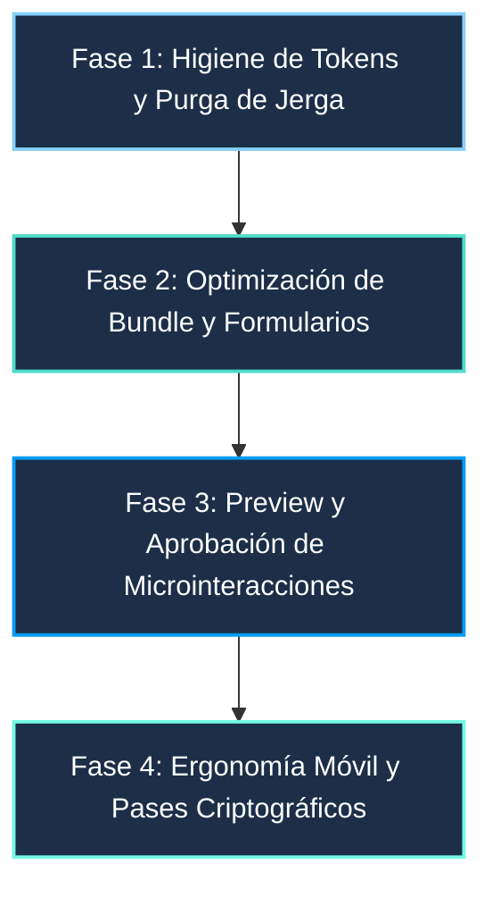

# Hoja de Ruta de Optimización y Refinamiento del Frontend (Amaryllis B2C)

Este documento define el plan de trabajo estructurado en fases autocontenidas para la optimización técnica, limpieza de tokens de diseño y humanización de la experiencia de usuario en el frontend de Amaryllis Ticketing.

---

## Directrices Clave del Proyecto
1. **Puntualidad en Sala de Espera (`QueueView`):** Cero sobrecarga de recursos (sin audio, sin visuales pesados). Mantener la vista liviana, ultra-rápida y clara, enfocándose exclusivamente en legibilidad y en erradicar la jerga de backend ("Redis Gate", "Sorted Sets FIFO").
2. **Microinteracciones de Reserva:** Requieren revisión y validación previa mediante preview antes de su integración en el código de producción.
3. **Calidad y Tests:** Toda fase debe mantener pasando el 100% de la suite de Vitest (87 tests en 11 archivos) y cero errores en `vue-tsc --build`.

---



---

## Fase 1: Higiene de Tokens de Diseño y Purga de Jerga Técnica
> **Objetivo:** Eliminar la inconsistencia cromática en vistas secundarias y sustituir la terminología de ingeniería interna por lenguaje centrado en el asistente al recital.  
> **Comando de verificación:** `bun run --cwd ticketing-frontend test:unit -- --run`

### Tareas Detalladas

#### 1.1. Unificación de Tokens CSS
- **Archivos a intervenir:**
  - `ticketing-frontend/src/views/DashboardTicketsView.vue` y subcomponentes en `src/components/dashboard/`.
  - `ticketing-frontend/src/views/SupportChatView.vue` y subcomponentes en `src/components/support/`.
  - `ticketing-frontend/src/views/QueueView.vue` y subcomponentes en `src/components/queue/`.
- **Acciones:**
  - Reemplazar clases Tailwind heredadas (`text-text-primary`, `text-text-secondary`, `bg-surface-base`, `text-primary-400`, `bg-secondary-500/10`) por los tokens semánticos definidos en `src/assets/main.css` (`text-high-emphasis`, `text-muted-light`, `bg-canvas-base`, `bg-surface-card`, `text-primary`, `text-secondary`).
  - Reemplazar estilos en línea o clases arbitrarias hexadecimales (`#0c141f`, `#141c27`, `#23354d`, `#86cffb`) por las utilidades estándar (`bg-canvas-base`, `bg-surface-card`, `border-border-subtle`, `text-primary`).

#### 1.2. Purga y Humanización del Copy B2C
- **Archivos a intervenir:**
  - `ticketing-frontend/src/components/ui/AppNavbar.vue` (Popovers y Badges de notificación).
  - `ticketing-frontend/src/components/queue/QueueHeader.vue` y `QueueView.vue`.
  - `ticketing-frontend/src/components/support/ChatHeader.vue`.
- **Matriz de Reemplazo de Textos:**

| Ubicación | Texto Actual (Jerga de Backend) | Texto Optimizado (Centrado en el Usuario) |
| :--- | :--- | :--- |
| **Navbar (Badge)** | `"Garantía Redlock • 10 minutos de reserva atómica"` | `"Reserva Garantizada • Tus asientos están guardados"` |
| **Queue Header** | `"Sala de Espera Concurrente • Redis Gate"` | `"Fila Oficial de Acceso • Alta concurrencia protegida"` |
| **Queue Footer** | `"Protegido por el sistema de colas (Redis Sorted Sets)."` | `"Sistema oficial de asignación equitativa. No cierres tu navegador para mantener tu posición."` |
| **Support Chat** | `"Spring WebFlux WebSocket • Redis Pub/Sub room: chat.room.default"` | `"Canal Seguro de Atención al Espectador • Encriptación de extremo a extremo"` |

---

## Fase 2: Optimización de Empaquetado y Formularios
> **Objetivo:** Resolver la advertencia de bundle size (>550 kB) en Vite y agregar formateo inteligente a los formularios de pago.  
> **Comando de verificación:** `bun run --cwd ticketing-frontend build`

### Tareas Detalladas

#### 2.1. Code-Splitting y Vendor Chunks en Vite
- **Archivo a intervenir:** `ticketing-frontend/vite.config.ts`.
- **Acción:** Configurar la estrategia de chunks manuales en Rollup:
  ```ts
  build: {
    rollupOptions: {
      output: {
        manualChunks: {
          'vendor-radix': ['radix-vue'],
          'vendor-router-pinia': ['vue', 'vue-router', 'pinia'],
          'vendor-qr': ['qrcode']
        }
      }
    }
  }
  ```
- **Meta:** Reducir el chunk principal a menos de 200 kB gzipped.

#### 2.2. Formateo y Validación Interactiva en Checkout
- **Archivo a intervenir:** `ticketing-frontend/src/components/checkout/CreditCardForm.vue`.
- **Acciones:**
  - Detección visual automática del emisor (Visa, Mastercard, Amex, Cabal) a partir del BIN introducido.
  - Formateo automático de espacios cada 4 dígitos (`1234 5678 9012 3456`).
  - Auto-inserción de barra diagonal en vencimiento (`MM/YY`).
  - Restricción estricta de caracteres numéricos en CVV (3 o 4 dígitos).

---

## Fase 3: Preview y Aprobación de Microinteracciones de Reserva
> **Objetivo:** Visualizar y acordar la experiencia de selección de butacas antes de tocar el código de `SeatSelectionView.vue`.  
> **Nota de Diseño:** No añadir librerías pesadas (ej. Three.js o GSAP). Utilizar animaciones CSS y SVG nativas optimizadas a 60 FPS.

### Propuesta Conceptual: "Tactile Bioluminescence"
En vez de que el asiento cambie abruptamente de color gris a celeste, la selección simula una respuesta háptica luminosa:

#### 1. Estado Disponible (Reposo)
```html
<g class="seat cursor-pointer transition-transform duration-150 hover:scale-125">
  <circle cx="10" cy="10" r="5" fill="#223756" stroke="#23354d" stroke-width="1.5" />
</g>
```
*Gris azulado reposado con borde sutil. No compite visualmente con el escenario.*

#### 2. Pulsación / Selección (Feedback Instantáneo)
```html
<g class="seat selected scale-110 transition-all duration-200">
  <!-- Anillo de onda expansiva que se desvanece (ripple keyframe) -->
  <circle cx="10" cy="10" r="8" fill="none" stroke="#4fdbc8" opacity="0.6" class="animate-ping" />
  <!-- Asiento relleno con cian vibrante -->
  <circle cx="10" cy="10" r="5.5" fill="#86cffb" stroke="#ffffff" stroke-width="1.5" />
</g>
```
*Efecto de onda expansiva de 300ms (`animate-ping` acotado) que da confirmación visual certera de que el asiento se apartó.*

#### 3. Reserva Confirmada (Lock Activo)
```html
<g class="seat locked">
  <circle cx="10" cy="10" r="5.5" fill="#019df4" stroke="#86cffb" stroke-width="1.5"
          filter="drop-shadow(0 0 6px rgba(1, 157, 244, 0.7))" />
</g>
```
*Brillo constante que identifica con claridad las butacas del usuario en el mapa global sin confundirlas con las de otros compradores.*

---

## Fase 4: Ergonomía Móvil y Pase Holográfico
> **Objetivo:** Optimizar el mapa en pantallas táctiles pequeñas y crear un boleto digital memorable.

### Tareas Detalladas

#### 4.1. Selector Asistido en Mobile (`SeatSelectionView`)
- En viewports menores a 640px:
  - Mantener la opción del mapa SVG interactivo.
  - Añadir un botón flotante: *"Elegir mejor asiento disponible"* que pre-selecciona automáticamente los asientos contiguos con mejor ángulo de visión hacia el escenario sin obligar al usuario a hacer pan/zoom microscópico.

#### 4.2. Efecto de Billete Digital Físico (`TicketPassCard`)
- Agregar muescas de perforación semicirculares en los laterales del divisor del ticket.
- Añadir un sutil gradiente holográfico en la tarjeta del QR dinámico que reaccione al hover en escritorio o con CSS estático de alta fidelidad, transmitiendo autenticidad de boleto coleccionable.

---

## Matriz de Verificación y Criterios de Aceptación
Para dar por concluida cada fase, el agente asignado debe ejecutar y validar:

1. **`bun run --cwd ticketing-frontend test:unit -- --run`**: 87/87 tests pasando en verde.
2. **`bun run --cwd ticketing-frontend type-check`**: Cero errores de TypeScript en `vue-tsc`.
3. **`bun run --cwd ticketing-frontend build`**: El empaquetado debe completarse sin advertencias de tamaño de chunk.
4. **`graphify update .`**: Actualizar el grafo de conocimiento del proyecto.
