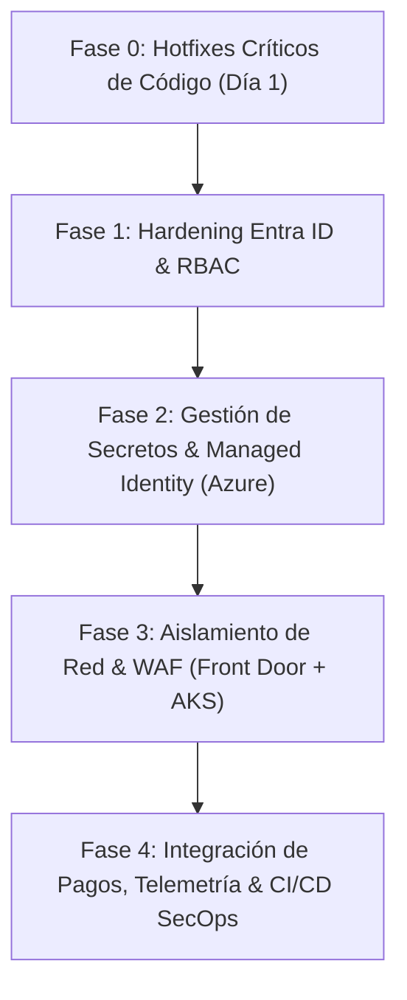
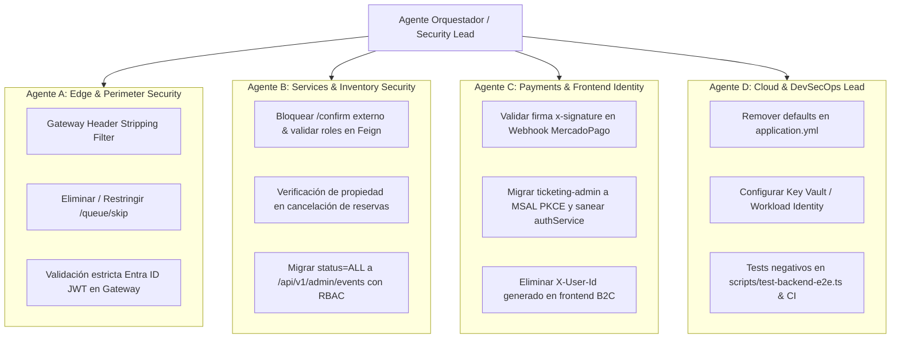

# Plan de Mitigación y Remediación de Seguridad: Hibana Ticketing

> **Fecha:** Noviembre 2026  
> **Estado:** Aprobado para Ejecución  
> **Referencia:** Auditoría de Seguridad & Arquitectura Azure  

---

## 1. Resumen Ejecutivo de Vulnerabilidades Encontradas

Tras la auditoría estática y dinámica de la solución completa (Spring Cloud Gateway, Microservicios de Catálogo, Inventario, Órdenes, y Frontends B2C/B2B), se identificaron fallas clave agrupadas en:

1. **Spoofing de Identidad y Roles por Headers HTTP (`C1`):**  
   Los microservicios internos (`catalog`, `inventory`, `orders`) consumían encabezados `X-User-Id` y `X-User-Roles` confiando ciegamente en ellos. El Gateway no sanitizaba estos encabezados en la entrada, permitiendo eludir el control de acceso inyectándolos desde un cliente externo.
2. **Bypass no autenticado de la Sala de Espera Virtual (`C2`):**  
   El endpoint `/api/v1/queue/skip` emitía `CheckoutToken` (HMAC JWT) válidos para cualquier usuario arbitrario sin requerir autenticación ni verificación de cola.
3. **Exposición pública de confirmación de reservas sin pago (`C3`):**  
   El endpoint `/api/v1/reservations/{id}/confirm` estaba ruteado públicamente en el Gateway bajo `/api/v1/reservations/**`. Adicionalmente, el release (`DELETE`) no verificaba que el solicitante fuera el dueño de la reserva.
4. **Validación laxa de JWTs de Microsoft Entra ID (`C4`):**  
   En `AdminRbacGatewayFilterFactory` y `FlociEntraJwksProvider` no se verificaban ni el `iss` (Issuer) ni el `aud` (Audience), y se utilizaba `/common` con fallback a cualquier clave pública en cache.
5. **Secretos Hardcodeados como Defaults (`C5`):**  
   Claves HMAC (`waiting-room-jwt-secret`), credenciales de base de datos y llaves de desarrollo presentes como valores por defecto en `application.yml`.
6. **Fugas de Información y Superficie de Exposición (`H1`, `H2`, `H3`, `H4`, `H5`):**  
   Endpoint `/actuator/gateway` expuesto públicamente; endpoint de listado con `status=ALL` desprotegido; webhook de MercadoPago sin validación de firma criptográfica; puertos de bases de datos y emuladores expuestos a `0.0.0.0`; y flujo ROPC con contraseñas fijas en frontend administrativo.

---

## 2. Hoja de Ruta de Mitigación por Fases

---

### Fase 0: Remediaciones Críticas Inmediatas (Backend & Gateway)

#### 0.1 Sanitización de Headers en Spring Cloud Gateway
- **Objetivo:** Eliminar cualquier cabecera de identidad proveniente del exterior antes de rutear el tráfico a los microservicios.
- **Acción:**
  - Implementar un `GlobalFilter` con orden `Ordered.HIGHEST_PRECEDENCE` que elimine explícitamente:
    - `X-User-Id`
    - `X-User-Roles`
    - `X-Roles`
    - `X-User-Email`
    - `X-Gateway-Auth-Stamp`
    - `X-Gateway-Signature`
  - Establecer firma HMAC interna entre Gateway y microservicios (`X-Gateway-Signature` con timestamp y nonce) para que ningún microservicio acepte cabeceras de identidad sin firma legítima del Gateway.

#### 0.2 Cierre y Restricción de la Sala de Espera (`/api/v1/queue`)
- Desactivar o restringir el endpoint `/api/v1/queue/skip` mediante condicional `@Profile({"test", "local-debug"})`. En producción, este endpoint no debe registrarse o debe retornar `404 Not Found`.
- El endpoint `/status` y `/stream` debe validar que el `userId` provenga de una sesión verificada o token de cola firmado y no permita consultar o extraer tokens de terceros.

#### 0.3 Aislamiento de Endpoints Internos de Inventario
- Modificar el ruteo en `application.yml` del Gateway para que `Path=/api/v1/reservations/**` **excluya** explícitamente `/api/v1/reservations/{reservationId}/confirm`.
- Proteger `/confirm` a nivel de Spring Security en `ticketing-app-inventory`: permitir únicamente llamadas autenticadas con identidad de servicio (`ROLE_SERVICE` o mTLS / Service Principal).
- En `ReservationController.releaseReservation`, validar que `res.getUserId()` coincida con el usuario autenticado en el contexto o cuente con `ROLE_ADMIN`.
- En `holdSeat`, tomar el `userId` garantizado por el `Claims.getSubject()` del `CheckoutToken` y no del payload JSON entrante.

#### 0.4 Protección del Catálogo Administrativo (`status=ALL`)
- Mover la consulta de eventos con estados no publicados (`DRAFT`, `CANCELLED`, `ALL`) a un endpoint restringido: `GET /api/v1/admin/events`.
- Requerir estrictamente `hasAnyRole('ROLE_ADMIN', 'ROLE_OPERATOR')` tanto en el Gateway (`AdminRbac`) como en el controlador de Catálogo.

---

### Fase 1: Integración Robusta con Microsoft Entra ID & RBAC

#### 1.1 Validación Estricta de Tokens OAuth2 / OIDC
- Configurar `NimbusJwtDecoder` en todos los servicios y `Jwts.parser()` en el Gateway con:
  - **Issuer exacto:** `https://login.microsoftonline.com/{tenant-id}/v2.0` (o URI de Floci-AZ en local).
  - **Audience exacto:** `api://hibana-api` o client ID específico.
  - **JWKS URI por Tenant:** Reemplazar `/common/discovery/v2.0/keys` por `https://login.microsoftonline.com/{tenant-id}/discovery/v2.0/keys`.
  - Eliminar el fallback permisivo de `FlociEntraJwksProvider` que utilizaba cualquier clave pública si el `kid` no coincidía.

#### 1.2 Limpieza del Mecanismo de Roles
- Eliminar el mapeo manual por correo (`alex.thorne@hibana.tk` -> `ROLE_ADMIN`) fuera de entornos locales de prueba.
- Configurar App Roles dentro de la App Registration de Azure Entra ID (`ROLE_ADMIN`, `ROLE_OPERATOR`, `ROLE_USER`) para que vengan inyectados de forma criptográfica en el claim `roles` del JWT.

#### 1.3 Migración de Autenticación en Back-Office (`ticketing-admin`)
- Reemplazar el grant `Resource Owner Password Credentials` (ROPC con `dev-pass-123`) por el estándar **Authorization Code Flow con PKCE** utilizando `@azure/msal-browser`.
- Almacenar los tokens en memoria (`sessionStorage` como fallback transitorio) y eliminar tokens mockeados en builds de producción.

---

### Fase 2: Gestión Centralizada de Secretos & Managed Identity (Azure)

#### 2.1 Eliminación de Fallbacks en Código
- Remover valores por defecto literales (e.g. `virtual-waiting-room-hmac-key-...`, `dev_password_123`) en `application.yml`.
- La aplicación debe fallar en el arranque (`fail-fast`) si no se suministran las variables de entorno correspondientes o la referencia a Key Vault.

#### 2.2 Adopción de Azure Key Vault & Secrets Store CSI Driver
- Almacenar en Azure Key Vault:
  - Claves criptográficas del Waiting Room (`waiting-room-jwt-secret`).
  - Secretos de integración con pasarelas de pago (`mercadopago-access-token`, `mercadopago-webhook-secret`).
  - Clave de firma inter-servicio Gateway Stamp (`gateway-hmac-secret`).
- Montar los secretos como volúmenes o variables nativas en Azure Kubernetes Service (AKS) mediante el Secrets Store CSI Driver.

#### 2.3 Passwordless Architecture con Entra Managed Identities
- Habilitar **Workload Identity** en los pods de AKS.
- **Azure Database for PostgreSQL Flexible Server:**
  - Desactivar autenticación por contraseña nativa para microservicios.
  - Conectar mediante Azure AD Authentication utilizando tokens emitidos por Managed Identity.
  - Crear roles independientes por contexto: `catalog_user`, `inventory_user`, `orders_user` en sus respectivos esquemas/bases.
- **Azure Service Bus & Blob Storage:**
  - Otorgar roles RBAC `Azure Service Bus Data Sender / Receiver` y `Storage Blob Data Contributor` a la Managed Identity de cada pod.
  - Eliminar Connection Strings estáticas con Access Keys.

---

### Fase 3: Hardening de Red, Contenedores y Edge Protection

#### 3.1 Topología de Red y Aislamiento Perimetral
- Desplegar Azure Front Door (o Application Gateway) con **Azure Web Application Firewall (WAF)** activado:
  - Conjunto de reglas administradas (OWASP Core Rule Set 3.2+).
  - Rate Limiting centralizado en el borde.
  - Restricción geográfica y protección DDoS.
- Los microservicios dentro de AKS no expondrán IPs públicas ni LoadBalancers externos (únicamente `ClusterIP`).
- Definir **Kubernetes NetworkPolicies**:
  - Tráfico HTTP entrante permitido a los microservicios únicamente desde los pods del `ticketing-app-gateway`.
  - Tráfico entre microservicios restringido exclusivamente a las comunicaciones Feign requeridas (e.g., `orders` -> `inventory`).
- Utilizar **Azure Private Endpoints** para PostgreSQL, Redis, Key Vault y Service Bus, eliminando accesos vía internet pública.

#### 3.2 Restricción de Entornos Locales (`docker-compose.yml`)
- Vincular puertos de infraestructura exclusivamente a `127.0.0.1` (`127.0.0.1:5432:5432`, `127.0.0.1:6379:6379`).
- Establecer contraseña obligatoria en Redis local (`--requirepass`).
- Revisar y restringir el montaje del socket `/var/run/docker.sock` en el contenedor `floci-az`.

#### 3.3 Blindaje de Actuator y Diagnóstico
- Configurar Actuator en un puerto administrativo aislado (`management.server.port=8090`).
- Excluir el endpoint sensible `/actuator/gateway` del mapeo público.
- Configurar `management.endpoint.health.show-details: when_authorized` o `never` en perfiles productivos.

---

### Fase 4: Pagos, Observabilidad y Verificación Continua

#### 4.1 Verificación de Integridad de Webhooks (MercadoPago)
- Implementar en `MercadoPagoWebhookController` la validación obligatoria del header `x-signature`:
  - Extraer `ts` y `v1` de la firma.
  - Calcular HMAC-SHA256 sobre el `x-request-id`, timestamp y body contra el secreto provisto por Key Vault.
  - Rechazar con `401 Unauthorized` cualquier notificación con firma inválida o timestamp desfasado (> 5 minutos).

#### 4.2 Telemetría y Alertas de Seguridad
- Registrar eventos de seguridad estructurados (autenticaciones fallidas, rechazos de RBAC 403, intentos de spoofing de headers) dirigidos a **Azure Monitor / Application Insights**.
- Respetar el flujo distribuido propagando `Trace-ID` en todos los saltos.
- Ofuscar/enmascarar identificadores sensibles y tokens en logs (`log.debug` / `log.info`).

#### 4.3 Pipeline DevSecOps (CI/CD)
- Integrar escaneo de secretos en commits y PRs mediante **Gitleaks** / **TruffleHog**.
- Integrar análisis estático de vulnerabilidades de dependencias (OWASP Dependency-Check / Trivy / Snyk).
- Incorporar tests de integración negativos en el suite e2e (`scripts/test-backend-e2e.ts`):
  - Inyección no autorizada de `X-User-Id` / `X-User-Roles`.
  - Intento de bypass de sala de espera sin token válido.
  - Intento de confirmación de reserva directa sin pasar por el flujo de pago.
  - Solicitud administrativa con token de usuario regular.

---

## 3. Matriz de Responsabilidad y Priorización

| Item | Tarea Técnica | Impacto | Prioridad | Esfuerzo Estimado |
|---|---|---|---|---|
| **0.1** | Strip de cabeceras de usuario en Gateway + Firma HMAC inter-servicio | Crítico | P0 | 4 horas |
| **0.2** | Restricción/eliminación de `/api/v1/queue/skip` y validación de cola | Crítico | P0 | 2 horas |
| **0.3** | Bloqueo de `/reservations/{id}/confirm` en Gateway y control de dueño en DELETE | Crítico | P0 | 3 horas |
| **0.4** | Migración y gater de `GET /events?status=ALL` a `/admin/events` | Alto | P0 | 2 horas |
| **1.1** | Validación estricta de `iss`, `aud`, JWKS tenant en Gateway y Apps | Crítico | P1 | 6 horas |
| **1.3** | Migración del login Back-Office a MSAL PKCE | Alto | P1 | 6 horas |
| **2.1** | Remoción de valores por defecto en configs YAML | Alto | P1 | 2 horas |
| **4.1** | Validación de firma HMAC en Webhook de MercadoPago | Alto | P1 | 4 horas |
| **2.2** | Configuración Azure Key Vault + Secrets Store CSI Driver | Alto | P2 | 8 horas |
| **2.3** | Passwordless con Azure Entra Workload Identity (DB, Bus, Storage) | Alto | P2 | 12 horas |
| **3.1** | WAF en Front Door + NetworkPolicies en AKS + Private Endpoints | Alto | P2 | 16 horas |
| **3.3** | Aislamiento de Actuator en puerto separado | Medio | P3 | 3 horas |

---

## 4. Plan de Ejecución Multi-Agente (Workstreams Paralelos)

Para maximizar la eficiencia y velocidad de remediación, el trabajo se distribuye entre **4 agentes especializados** con límites claros de bounded context y ramas de Git dedicadas para evitar colisiones.

### 4.1 Definición de Agentes y Responsabilidades

#### 🤖 Agente A — Especialista Gateway & Perímetro
- **Rama asignada:** `feature/security-gateway-perimeter`
- **Ámbito:** `ticketing-app-gateway/`
- **Tareas asignadas:**
  1. **[P0] Header Stripping & Sanitization:** Crear `StripInboundSecurityHeadersFilter` (`Ordered.HIGHEST_PRECEDENCE`) para remover cabeceras entrantes `X-User-Id`, `X-User-Roles`, `X-Roles`, `X-Gateway-Auth-Stamp` antes del procesamiento de rutas.
  2. **[P0] Waiting Room Skip Gating:** Deshabilitar o aislar bajo `@Profile({"test", "local-debug"})` el endpoint `POST /api/v1/queue/skip`. Validar en `/status` y `/stream` que el usuario solo pueda leer su propio estado.
  3. **[P1] JWT Validation Rigor:** En `AdminRbacGatewayFilterFactory` y `FlociEntraJwksProvider`, aplicar validación obligatoria de `issuer` y `audience`. Remover fallback de "cualquier clave en caché".
  4. **[P3] Actuator Hardening:** Deshabilitar endpoint `gateway` de actuator en entornos de producción y limitar exposición.

#### 🤖 Agente B — Especialista Microservicios & Inventario
- **Rama asignada:** `feature/security-services-inventory`
- **Ámbito:** `ticketing-app-inventory/`, `ticketing-app-catalog/`, `ticketing-app-orders/` (comunicación interna)
- **Tareas asignadas:**
  1. **[P0] Aislamiento de `/confirm`:** En `ticketing-app-inventory`, asegurar que `POST /api/v1/reservations/{reservationId}/confirm` solo acepte invocaciones autenticadas con rol de servicio interno (`ROLE_SERVICE`).
  2. **[P0] Control de acceso en cancelación:** En `ReservationController.releaseReservation`, rechazar cancelaciones si el usuario no es el titular de la reserva ni posee `ROLE_ADMIN`.
  3. **[P0] Eventos Administrativos:** En `ticketing-app-catalog`, migrar la consulta de estados arbitrarios a `GET /api/v1/admin/events` exigiendo `ROLE_ADMIN` / `ROLE_OPERATOR`. Actualizar `EventAdminController`.
  4. **[P1] HMAC Gateway Stamp:** Implementar en los 3 microservicios la verificación de firma interna del Gateway antes de consumir los claims inyectados.

#### 🤖 Agente C — Especialista Pagos & Frontend Identity
- **Rama asignada:** `feature/security-payments-frontend`
- **Ámbito:** `ticketing-app-orders/src/.../web/MercadoPagoWebhookController.java`, `ticketing-admin/`, `ticketing-frontend/`
- **Tareas asignadas:**
  1. **[P1] Verificación Criptográfica Webhook MercadoPago:** Validar cabecera `x-signature` (HMAC-SHA256 con timestamp y request-id contra secreto seguro). Retornar `401 Unauthorized` ante fallos de firma.
  2. **[P1] Migración Frontend Admin a MSAL PKCE:** Reemplazar el grant ROPC y password fijo en `authService.ts` por flujo Authorization Code con PKCE. Eliminar tokens mockeados en producción.
  3. **[P0] Sanitización Frontend B2C:** En `ticketing-frontend/src/services/apiClient.ts`, eliminar la inyección de `X-User-Id` arbitrario desde el cliente del navegador.
  4. **[P2] Sanitización v-html:** Reemplazar o sanitizar el `v-html` en `HelpFaqAccordion.vue` con DOMPurify.

#### 🤖 Agente D — Especialista Azure Cloud & DevSecOps
- **Rama asignada:** `feature/security-cloud-devsecops`
- **Ámbito:** `docker-compose.yml`, `*/resources/application*.yml`, `infra/`, `scripts/test-backend-e2e.ts`
- **Tareas asignadas:**
  1. **[P1] Eliminación de Secretos en Repositorio:** Remover todos los valores por defecto de secretos en archivos YAML (`WAITING_ROOM_JWT_SECRET`, passwords de base de datos, connection strings).
  2. **[P2] Hardening Local Docker:** Ajustar `docker-compose.yml` para bindear puertos de DB, Redis y Floci a `127.0.0.1`. Agregar clave a Redis local.
  3. **[P1] Suite de Pruebas de Seguridad E2E:** Agregar escenarios de prueba negativos en `scripts/test-backend-e2e.ts`:
     - Inyección de headers de usuario desde cliente externo -> debe ser ignorada/rechazada.
     - Bypass de sala de espera -> 404 o 403.
     - Confirmación directa de reserva no autorizada -> 403 Forbidden.
     - Consulta a `/admin/events` sin token admin -> 401/403.
  4. **[P2] Configuración de Key Vault & Workload Identity:** Preparar templates/Bicep para conexión passwordless mediante Entra ID hacia PostgreSQL, Service Bus y Storage.

---

### 4.2 Protocolo de Coordinación y Fusión

1. **Orden de Ejecución:**
   - **Ola 1 (Simultánea):** Agentes A, B y C trabajan en paralelo en sus respectivas ramas implementando P0 y P1.
   - **Ola 2:** Agente D actualiza los archivos de configuración (`application.yml`), docker y el suite E2E una vez consolidadas las firmas y endpoints de Ola 1.
2. **Criterios de Aceptación y Gates de Integración:**
   - Cada rama debe compilar exitosamente (`./gradlew test` en los servicios afectados y `bun run build` en los frontends).
   - Ninguna suite existente puede romperse.
   - Agente D ejecuta `bun run test:e2e` para validar la efectividad de las defensas antes de hacer merge a `main`.

