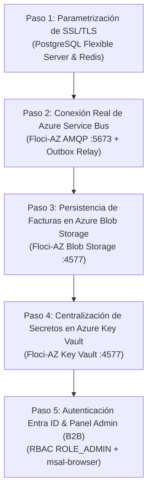

# Plan de Refactorización y Adopción Nativa de Azure con Floci-AZ

Fecha de Inicio: 2026-11-02
Estado: Paso 1 y Paso 2 Completados (Listo para Paso 3)
Objetivo: Adaptar todos los microservicios de Hibana.tk para utilizar los componentes y SDKs nativos de Microsoft Azure, asegurando compatibilidad 100% en local mediante Floci-AZ a costo cero y en producción en Azure PaaS/AKS.

---

## 1. Arquitectura de Servicios y Mapeo Local vs. Producción

| Servicio Azure | Emulador Local (Floci-AZ / Compose) | Rol en Hibana.tk | SDK / Mecanismo de Integración |
| :--- | :--- | :--- | :--- |
| **Azure Service Bus (Premium)** | `floci-az:5673` (AMQP 1.0 Artemis) | Coreografía de eventos asíncronos (`order.lifecycle.v1`, `event.lifecycle.v1`) | `com.azure:azure-messaging-servicebus` / Connection String con `UseDevelopmentEmulator=true` |
| **Azure Key Vault** | `floci-az:4577/hibana-keyvault` | Secretos, llaves Ed25519, JWT HMAC keys y tokens de pasarelas | `com.azure:azure-security-keyvault-secrets` / Secrets Store CSI Driver en AKS |
| **Azure Blob Storage** | `floci-az:4577/hibanastorage` | Facturas PDF generadas (`invoices/{orderId}.pdf`) y assets de eventos | `com.azure:azure-storage-blob` / SAS Tokens |
| **Azure Database for PostgreSQL** | `pgvector/pgvector:pg17` (puerto 5432) | Almacenamiento relacional transaccional y vector embeddings | Spring Data JPA / `sslmode=${DB_SSL_MODE:disable}` en local, `sslmode=require` en Azure |
| **Azure Cache for Redis** | `redis:7-alpine` (puerto 6379) | Redlock (bloqueo distribuido) y Sala de Espera (Sorted Sets) | Spring Data Redis / TLS `port: 6380` con `ssl: true` en Azure |
| **Microsoft Entra ID (IAM)** | Token Provider / Mock dev | Autenticación OAuth2/OIDC, tokens JWT y RBAC (`ROLE_USER`, `ROLE_ADMIN`, `ROLE_OPERATOR`) | `spring-boot-starter-oauth2-resource-server` |

---

## 2. Fases del Plan de Refactorización

---

## 3. Estado de Ejecución

### Paso 1: Parametrización SSL/TLS (PostgreSQL & Redis)
- [x] Parametrizar `ticketing-app-catalog`: `DB_SSL_MODE` y `REDIS_SSL`.
- [x] Parametrizar `ticketing-app-inventory`: `DB_SSL_MODE` y `REDIS_SSL`.
- [x] Parametrizar `ticketing-app-orders`: `DB_SSL_MODE` y `REDIS_SSL`.
- [x] Parametrizar `ticketing-app-gateway`: `REDIS_SSL`.
- [x] Verificar que la ejecución local continúe intacta sin errores de conexión.

### Paso 2: Conexión Real de Azure Service Bus (Floci-AZ)
- [x] Configurar `docker-compose.yml`: habilitar `FLOCI_AZ_SERVICES_SERVICE_BUS_MOCKED: false` y `FLOCI_AZ_SERVICES_SERVICE_BUS_START_ON_BOOT: true` en `floci-az`.
- [x] Incorporar `com.azure:azure-messaging-servicebus:7.17.7` en `orders`, `catalog` e `inventory`.
- [x] En `orders`, implementar `ServiceBusEventPublisherAdapter` que despacha eventos al topic `order.lifecycle.v1`.
- [x] En `catalog`, implementar `ServiceBusEventPublisherAdapter` para el topic `event.lifecycle.v1`.
- [x] En `inventory`, conectar `AzureServiceBusSubscriptionReceiver` para escuchar `event.lifecycle.v1` (`ticketing-seat-generator`) y delegar a `EventCreatedAmqpListener`.
- [x] Verificar funcionamiento con test suites de cada microservicio y script E2E de extremo a extremo.

### Paso 3: Persistencia de Facturas en Azure Blob Storage
- [ ] Crear puerto `InvoiceStoragePort` en `orders`.
- [ ] Implementar `AzureBlobInvoiceStorageAdapter` con `com.azure:azure-storage-blob` apuntando a `http://floci-az:4577/hibana-storage`.
- [ ] Guardar PDF al confirmar pago y servir desde blob en descargas posteriores.

### Paso 4: Centralización en Azure Key Vault
- [ ] Integrar `com.azure:azure-security-keyvault-secrets` en `gateway` y `orders`.
- [ ] Resolver secret de JWT y llaves de firma desde el Key Vault emulado.

### Paso 5: Autenticación Entra ID & Panel Admin
- [ ] Configurar Spring Security OAuth2 Resource Server para validar tokens Entra ID con `ROLE_ADMIN`.
- [ ] Crear estructura base de `ticketing-admin-frontend` en Vue 3 con `@azure/msal-browser`.
