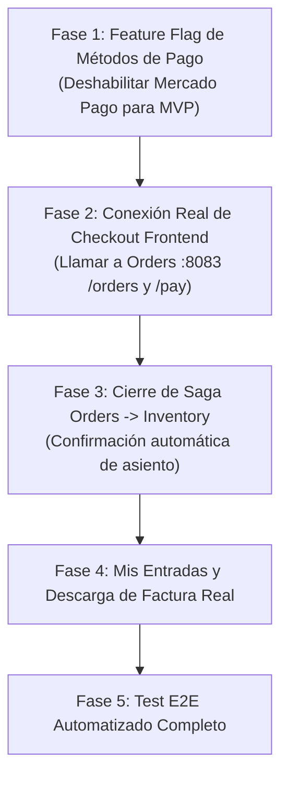

# Plan de Lanzamiento Hibana.tk — Minimum Viable Product (MVP)

Fecha: 2026-11-02
Estado: Completado y Verificado (Listo para Demostración / Producción Local)
Objetivo: Cerrar el ciclo de vida de punta a punta (End-to-End) en producción local sin dependencias simuladas en memoria para el comprador B2C.

---

## 1. Diagnóstico del Estado Actual

### Componentes Listos & Verificados
- **Infraestructura (`docker-compose.yml`)**:
  - PostgreSQL 17 + `pgvector` con migraciones consolidadas (`V1`, `V2`).
  - Redis 7 con algoritmo Redlock (TTL 10 min) y Sorted Sets para Sala de Espera.
  - Floci-AZ (emulación local Azure Service Bus & Key Vault).
  - Mailpit (servidor SMTP e inspección de correos en `:8025`).
- **Catalog Microservice (`:8081`)**:
  - Eventos, recintos, sectores, capacidades y precios limpios (sin centavos fraccionados).
  - Endpoints REST `/api/v1/events`, `/api/v1/events/{id}`.
- **Inventory Microservice (`:8082`)**:
  - Bloqueo atómico distribuido con Redis (`lock:event:{eventId}:seat:{seatId}`).
  - Reservas `PENDING` -> `CONFIRMED` / `RELEASED`.
  - Transactional Outbox con `OutboxRelayScheduler`.
  - Endpoints `/api/v1/reservations`, `/api/v1/reservations/{id}/confirm`, `/api/v1/events/{id}/seats`.
- **Spring Cloud Gateway (`:8080`)**:
  - Sala de espera virtual integrada (`/api/v1/queue/join`, `/api/v1/queue/status`, `/api/v1/queue/stream` SSE).
  - Filtro `CheckoutTokenFilterFactory` que exige JWT HMAC-SHA256 para reservar asientos.
  - Rate limiting (100 req/min por IP) y Resilience4j Circuit Breakers.
  - Portal de documentación Swagger / OpenAPI 3.1 & AsyncAPI 3.0 en `/docs`.
- **Orders & Financial Engine (`:8083`)**:
  - Ciclo de vida de órdenes (`PENDING_PAYMENT` -> `PAID` / `CANCELLED`).
  - Contabilidad de doble entrada (`ledger_accounts`, `ledger_entries`).
  - Generación de facturas oficiales en PDF con OpenPDF (`GET /api/v1/orders/{id}/invoice`).
  - Despacho de emails transaccionales con adjunto PDF a través de Mailpit.
  - Outbox transaccional de órdenes (`OrderPaidEvent`).
- **Frontend Front-Office B2C (`:5173`)**:
  - Catálogo, detalle de evento, sala de espera reactiva y mapa de asientos por sectores (Canvas/SVG).

---

## 2. Brechas para Alcanzar el MVP (Gaps)

1. **Frontend Checkout Simulado**:
   - `CheckoutView.vue` genera un ID `ORD-XXXXX` con `Date.now()` en el navegador y simula el pago con `setTimeout` en lugar de llamar a `POST /api/v1/orders` y `POST /api/v1/orders/{id}/pay`.
2. **Confirmación Automática de Inventario (Saga)**:
   - Al pagarse una orden, `inventory` debe confirmar la reserva del asiento para que pase de `HELD` a `BOOKED` definitivamente.
3. **Módulo Mercado Pago**:
   - Falta completar la reconciliación del webhook (asociar `payment_id` con `order_id` vía `external_reference`), validación de firma criptográfica y redirección al Checkout Pro.
   - **Decisión MVP**: Deshabilitarlo mediante Feature Flag configurable (tanto en Backend como en Frontend con badge *"Próximamente"*), priorizando pagos con Tarjeta de Débito y Crédito directos.
4. **Persistencia de "Mis Entradas"**:
   - El dashboard de entradas lee de `localStorage`. Debe permitir consultar órdenes reales por usuario / email para volver a descargar la factura PDF.

---

## 3. Fases de Ejecución del MVP

### Fase 1: Feature Flagging de Medios de Pago
- [x] Backend: Agregar configuración `payment.methods.mercado-pago.enabled: false` en `ticketing-app-orders/src/main/resources/application.yml`.
- [x] Backend: Exponer endpoint `GET /api/v1/orders/payment-methods` con el estado activo/inactivo de cada método.
- [x] Backend: Si se intenta pagar con un método inactivo, responder HTTP 400 Bad Request (`PaymentMethodDisabledException`).
- [x] Frontend: En `PaymentTabs.vue`, mostrar Mercado Pago deshabilitado con etiqueta informativa *"Próximamente"* o deshabilitar su selector.

### Fase 2: Conexión Real del Checkout (Frontend ➔ Gateway ➔ Orders)
- [x] Actualizar `orderService.ts` con `createOrder()` y `processPayment()`.
- [x] En `CheckoutView.vue`, reemplazar la simulación local:
  1. Invocar `orderService.createOrder()` con `reservationId`, `eventId`, `seatId`, `subtotal` y `serviceFee`.
  2. Invocar `orderService.processPayment()` con método de pago seleccionado, cuotas y datos del pagador.
  3. Redirigir a la pantalla de éxito con el `orderId` real y descargar la factura PDF generada por el backend.

### Fase 3: Confirmación de Saga (Orders ➔ Inventory)
- [x] Al recibir confirmación de pago en `ProcessPaymentCommandHandler`:
  - Disparar la confirmación del asiento en Inventario (`POST /api/v1/reservations/{reservationId}/confirm`).
  - Garantizar idempotencia si la reserva ya estaba confirmada.

### Fase 4: Persistencia y Consulta de Entradas
- [x] Endpoint `GET /api/v1/orders?userId={userId}` o `GET /api/v1/orders/{orderId}` para recuperar el detalle de la compra.
- [x] Conectar `DashboardTicketsView.vue` para que liste las órdenes pagadas y permita descargar la factura PDF oficial en cualquier momento.

### Fase 5: Verificación E2E Integral
- [x] Ejecutar prueba de extremo a extremo automatizada verificando:
  - Cola Virtual -> Token JWT -> Redlock -> Creación de Orden -> Pago Tarjeta -> Despacho Email Mailpit -> Descarga Factura PDF.
